# SaludRed — Coordinación de camas hospitalarias en red EPS/IPS

SaludRed es un sistema de gestión y asignación de camas para una EPS que coordina varias IPS.
Combina una API REST (FastAPI), una interfaz web por rol (React), analítica de la red, un servicio de
inteligencia artificial con firma clínica, facturación en MongoDB e interoperabilidad con HL7 FHIR R4.
Es un sistema activo: los hechos relevantes (una alerta crítica, una remisión, una factura, un resultado
de laboratorio externo) llegan a quien corresponde en segundos, sin recargar la página.

Proyecto del curso «Sistemas en Salud Digital». Todos los datos de la red son sintéticos o provienen de
conjuntos públicos con licencia abierta ([`docs/DATASETS.md`](docs/DATASETS.md)).

## Contenido

1. [El problema](#el-problema)
2. [Arquitectura](#arquitectura)
3. [Diagrama de servicios](#diagrama-de-servicios)
4. [Diagrama de eventos](#diagrama-de-eventos)
5. [Diagrama del intercambio con el socio](#diagrama-del-intercambio-con-el-socio)
6. [Stack](#stack)
7. [Mapa de requisitos R01–R34](#mapa-de-requisitos-r01r34)
8. [Mapa de requisitos a leyes R23–R33](#mapa-de-requisitos-a-leyes-r23r33)
9. [Puesta en marcha y despliegue](#puesta-en-marcha-y-despliegue)
10. [Pruebas](#pruebas)
11. [Autenticación, roles y usuarios de prueba](#autenticación-roles-y-usuarios-de-prueba)
12. [Modelo de datos](#modelo-de-datos)
13. [Datos y licencias](#datos-y-licencias)
14. [Documentación](#documentación)
15. [Seguridad](#seguridad)
16. [Estado y limitaciones](#estado-y-limitaciones)

## El problema

La información sobre ocupación, altas, limpieza, bloqueos y disponibilidad de camas está fragmentada y se
actualiza tarde. La consecuencia no es necesariamente falta de camas: puede existir capacidad física
suficiente, pero si el estado de una cama no se conoce a tiempo, esa cama no se puede usar.

Eso produce esperas para pacientes que requieren hospitalización, llamadas y verificaciones repetidas entre
áreas, información duplicada y ausencia de trazabilidad sobre quién cambió un dato y cuándo.

El sistema ataca cuatro puntos concretos:

| Principio | Qué significa en el sistema |
|---|---|
| Visibilidad | todos los actores autorizados consultan el mismo estado |
| Oportunidad | el cambio se registra cuando ocurre, no cuando alguien pregunta |
| Coordinación | solicitudes, asignaciones y estados se comparten entre IPS |
| Trazabilidad | cada cambio deja registro de qué cambió, cuándo y quién lo hizo |

Una EPS coordina una red de IPS. Cada IPS opera sedes, servicios, habitaciones y camas. El modelo es
jerárquico y autorreferenciado: incorporar una IPS nueva o una cama nueva es una inserción, nunca una
migración de esquema.

```
EPS
 ├── IPS Norte ── sede ── servicio ── habitación ── cama
 ├── IPS Sur   ── sede ── servicio ── habitación ── cama
 └── IPS Centro ─ sede ── servicio ── habitación ── cama
```

## Arquitectura

| Servicio | Rol | Exposición |
|---|---|---|
| `web` | nginx: sirve la SPA de React y hace de proxy inverso de `/api/`, `/health`, `/docs`. El navegador usa un solo origen, sin CORS. Aplica el límite de tasa y la `Content-Security-Policy`. Tiene ubicaciones dedicadas para el WebSocket y el SSE, sin búfer. | Puerto 8081 |
| `api` | FastAPI: autenticación JWT, control de acceso por rol, institución y pertenencia, operaciones lógicas (editar, borrar, restaurar), auditoría, bus de eventos, canal en vivo, sincronización con FHIR. Corre **un solo proceso** a propósito (el registro de conexiones en vivo vive en memoria). | Puerto 8000 |
| `ml` | Servicio de IA (FastAPI y scikit-learn) con dos modelos: criticidad del paciente y retraso de limpieza. No accede a la base de datos y rechaza campos fuera de su contrato. | Solo red interna |
| `mongo` | MongoDB 7: colección `facturas` (contabilidad), sin datos personales. | Solo red interna |
| `hapi` | Servidor HAPI FHIR R4 v7.4.0. Avisa a la API mediante una `Subscription` rest-hook cuando llega una `Observation`. | Puerto 8080 |
| PostgreSQL de la aplicación | Fuente de verdad operativa y clínica. En el despliegue es una base gestionada en Neon; en desarrollo, el contenedor `db`. | `db`: puerto 5433 |
| PostgreSQL de HAPI | Base propia del servidor FHIR, separada de la de la aplicación. En el despliegue es una base en Neon; en desarrollo, el contenedor `hapi-db`. | Solo red interna |
| `tunnel-web`, `tunnel-api`, `tunnel-fhir` | Túneles rápidos de Cloudflare (`cloudflared`, arrancan con el mismo `up -d`) que publican la interfaz, la API y el servidor FHIR con URL HTTPS. | Conexión saliente |
| `orthanc` | Servidor PACS con los píxeles de las imágenes. El navegador nunca le habla: toda imagen pasa por la API. | `127.0.0.1:8042` |

Dentro del servicio `api` conviven, como módulos del mismo proceso, las piezas de la entrega final:

| Pieza | Qué hace | Código | Documento |
|---|---|---|---|
| Agente clínico | Agente de LangChain y LangGraph (`/api/v1/agente/*`) con herramientas por rol, aprobación humana para remitir y defensa contra inyección. La IPS y el paciente salen de la sesión, no del texto | `app/services/agent/`, `app/api/routes/agent.py` | [`docs/AGENTE.md`](docs/AGENTE.md) |
| RAG | Recuperación híbrida (BM25, vectores con pgvector, RRF y MMR) sobre las guías declaradas en `## Corpus`; cada respuesta cita documento y fragmento y, sin evidencia, se abstiene (`/api/v1/rag/*`) | `app/services/rag/`, `app/api/routes/rag.py` | [`docs/RAG.md`](docs/RAG.md), [`docs/DATASETS.md`](docs/DATASETS.md) |
| Proveedor de LLM | Groq, solo con texto seudonimizado; si no responde, el agente y el RAG degradan a búsqueda extractiva en las guías. Es un servicio externo | `app/services/rag/llm.py`, `app/services/agent/model.py` | [`docs/AGENTE.md`](docs/AGENTE.md) |
| Interoperabilidad con socios | Rutas en la raíz (`/oauth/token`, `/interop/*`) con token de sistema y firma por mensaje; remisión de ida y vuelta por `Bundle` y `Task` | `app/services/interop/`, `app/api/routes/interop.py` | [`docs/INTEROP.md`](docs/INTEROP.md) |
| Consentimientos | Consentimiento del paciente por destino, con vigencia y revocación; sin él no se remite a un socio (`/api/v1/consents`) | `app/services/consents.py`, `app/api/routes/consents.py` | [`docs/NORMATIVA.md`](docs/NORMATIVA.md) |
| Auditoría encadenada | Cada fila de `audit_log` guarda el hash de la anterior; verificación solo admin (`/api/v1/audit-logs/verify`) | `app/services/audit_chain.py`, `app/api/routes/audit.py` | [`docs/NORMATIVA.md`](docs/NORMATIVA.md) |

El modelo de amenazas con sus fronteras de confianza está en [`docs/STRIDE.md`](docs/STRIDE.md).

Decisiones que conviene conocer:

- **Dos bases, dos ciclos de vida.** La aplicación es dueña del modelo operativo; HAPI es dueño de la
  representación interoperable. Compartir una sola base acoplaría nuestras migraciones al esquema interno de HAPI.
- **PostgreSQL para lo clínico y MongoDB para lo financiero.** El contable no ve nada clínico y el médico no ve
  nada financiero; dos bases hacen esa separación física. Ver [`docs/CONTABILIDAD.md`](docs/CONTABILIDAD.md).
- **El PACS guarda los píxeles; la base guarda los metadatos** de cada estudio de imagen. La API valida el token
  y el rol antes de servir cualquier imagen y deja rastro en la auditoría.
- **El servicio `ml` está aislado:** sin puertos publicados y sin acceso a la base. La API le entrega solo
  variables clínicas minimizadas y un seudónimo ([`docs/IA.md`](docs/IA.md)).

## Diagrama de servicios

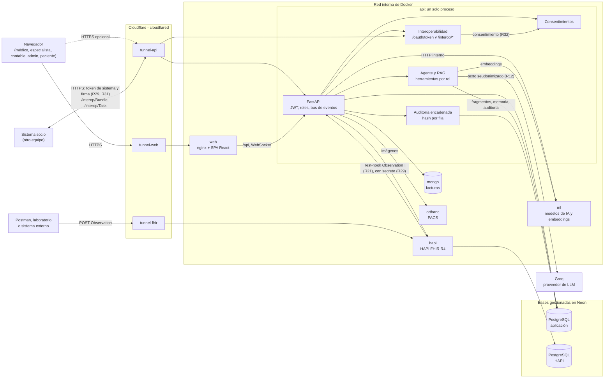

Las rutas `/oauth/token` y `/interop/*` entran por `tunnel-api` y no pasan por el nginx del contenedor `web`. El
agente y el RAG envían al LLM solo texto seudonimizado; si el proveedor no responde, degradan a una búsqueda
extractiva en las guías. El diagrama del intercambio con el socio, mensaje a mensaje, está más abajo.

## Diagrama de eventos

El bus de eventos (`app/events/`) publica un hecho de dominio después del commit y los reactores (notificar,
facturar, alertar, contar) reaccionan sin que ningún endpoint los conozca. El catálogo completo está en
[`docs/EVENTOS.md`](docs/EVENTOS.md).

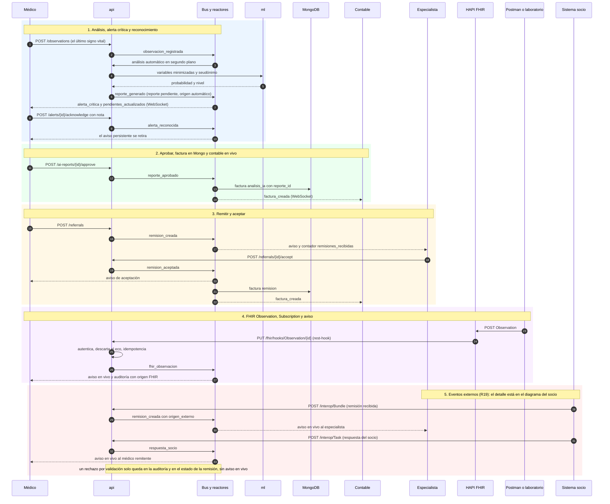

HAPI 7.4 entrega las suscripciones con una tarea programada de 5 s, así que el paso 4 tarda entre 5 y 9 s;
los demás flujos llegan en 2 a 5 s. Toda fila de auditoría de estos flujos entra a la cadena de hashes.

## Diagrama del intercambio con el socio

SaludRed hace de **A** cuando envía una remisión y de **B** cuando la recibe; el mismo código cumple los dos
papeles. El flujo, sus códigos de error y el control de consentimiento (R30 a R32) están descritos con detalle en
[`docs/INTEROP.md`](docs/INTEROP.md). Estado: probado en autobucle (SaludRed como su propio socio); la demostración
con otro equipo (R33) espera a que se asigne la pareja.

```mermaid
sequenceDiagram
    autonumber
    participant M as Médico de A
    participant A as SaludRed A
    participant B as Sistema B
    participant E as Especialista de B

    M->>A: POST /api/v1/interop/remisiones
    A->>A: rol y alcance del paciente
    alt sin consentimiento vigente para B (R32)
        A-->>M: 403, auditoría INTEROP_REJECTED; no se arma ni se envía nada
    else consentimiento vigente
        A->>A: Bundle mínimo: Patient solo con id federado, ServiceRequest, Observation del perfil, DiagnosticReport de IA aprobada
        A->>A: guarda la remisión como "enviando" antes del transporte
        A->>B: POST /oauth/token (client credentials)
        B-->>A: token de sistema de 10 minutos
        A->>B: POST /interop/Bundle (token, firma HMAC, nonce)
        B->>B: valida token, firma y perfil de TODO el Bundle antes de escribir
        alt no autenticado, sin alcance o repetido
            B-->>A: 401 firma o token (A renueva el token una vez y reintenta) / 403 sin alcance / 409 repetido, con OperationOutcome
            A-->>M: remisión en "error_envio"; el endpoint responde 502
        else no cumple el perfil
            B-->>A: 400 o 422 con OperationOutcome; B no guarda nada
            A-->>M: 201 con estado "rechazada_por_validacion" (sin aviso en vivo)
        else paciente o especialista sin resolver
            B-->>A: 202, el mensaje queda en la cola de conciliación del admin de B
            A-->>M: 201 con estado "enviada"
        else válido
            B->>B: una sola transacción: remisión, observaciones, informes, auditoría con origen externo
            B-->>A: 201 con OperationOutcome
            A-->>M: 201 con estado "enviada"
            B-->>E: remision_creada en vivo (bandeja y contador)
            E->>B: aceptar o rechazar la remisión (con motivo)
            B->>B: commit y Task en la bandeja de salida
            B->>A: POST /interop/Task (accepted o rejected, con motivo)
            alt Task válida y de un socio autorizado
                A->>A: actualiza la remisión enviada; auditoría con origen externo
                A-->>M: respuesta_socio en vivo
            else Task repetida
                A-->>B: 200, sin evento nuevo (idempotente)
            else remisión de otro socio o desconocida / respuesta contraria / Task inválida
                A-->>B: 404 / 409 / 422 con OperationOutcome
            end
        end
    end
```

Si la `Task` no llega al socio, la decisión del especialista no se revierte: queda en la bandeja de salida y el
administrador la reenvía con `POST /api/v1/interop/outbox/reintentar`.

## Stack

| Componente | Tecnología |
|---|---|
| Base de datos | PostgreSQL (16 en contenedor, Neon en despliegue) |
| API | Python 3.12 · FastAPI · SQLAlchemy 2 · Pydantic v2 |
| Migraciones | Alembic |
| Autenticación | JWT (HS256, 15 min, `iss`/`aud`) · hashing Argon2id (`pwdlib`) |
| Interoperabilidad | HAPI FHIR R4 (v7.4.0) |
| Imágenes médicas | Orthanc (PACS DICOM) |
| Contabilidad | MongoDB 7 · pymongo |
| Inteligencia artificial | Servicio `ml` (FastAPI · scikit-learn, regresión logística) |
| Agente y RAG | LangChain 1.4 y LangGraph · Groq como proveedor de LLM · recuperación híbrida (BM25, vectores con pgvector, RRF y MMR) |
| Intercambio con otros equipos | FHIR R4 (`Bundle`, `Task`, `ServiceRequest`, `Observation`, `DiagnosticReport`) · OAuth 2.0 client credentials · firma HMAC-SHA256 por mensaje |
| Tiempo real | WebSocket (público) y Server-Sent Events (red local) |
| Interfaz | React 18 · TypeScript · Vite · PrimeReact sin estilos · Tailwind 3.4 · TanStack Query |
| Servidor web | nginx |
| Documentación de API | OpenAPI/Swagger generado por FastAPI (`/docs`) |

## Mapa de requisitos R01–R34

| Requisito | Dónde está implementado | Documento |
|---|---|---|
| R01 Múltiples roles | `app/core/authz.py`, `app/models/identity.py`, `app/api/routes/accounts.py` | [`docs/NORMATIVA.md`](docs/NORMATIVA.md) |
| R02 Bloqueo por intentos fallidos | `app/services/auth.py`, `app/api/routes/accounts.py` | [`docs/EVENTOS.md`](docs/EVENTOS.md) |
| R03 Seguridad de acceso | `app/core/security.py`, `app/main.py`, `frontend/nginx.conf`, `.gitignore` | [`docs/NORMATIVA.md`](docs/NORMATIVA.md) |
| R04 Sistema en línea por túnel | servicios `tunnel-*` de `docker-compose.yml`, `deploy/urls-publicas.*` | este README |
| R05 Todo dockerizado | `docker-compose.yml`, `Dockerfile`, `ml/Dockerfile`, `frontend/Dockerfile` | este README |
| R06 Imágenes reales | `scripts/load_chest_xrays.py`, `app/services/pacs.py`, `app/api/routes/imaging.py` | [`docs/DATASETS.md`](docs/DATASETS.md) |
| R07 Base tabular y aumento por grupos | `app/services/cohort_builder.py`, `scripts/build_cohort.py`, `GET /api/v1/cohort/clusters` | [`docs/DATASETS.md`](docs/DATASETS.md) |
| R08 Remisión entre médicos | `app/services/referrals.py`, `app/api/routes/referrals.py` | [`docs/EVENTOS.md`](docs/EVENTOS.md), [`docs/INTEROPERABILIDAD.md`](docs/INTEROPERABILIDAD.md) |
| R09 Contabilidad en MongoDB | `app/billing/`, `app/api/routes/billing.py` | [`docs/CONTABILIDAD.md`](docs/CONTABILIDAD.md) |
| R10 Reporte de IA con aprobación | `app/services/ai_reports.py`, `app/api/routes/ai.py` | [`docs/IA.md`](docs/IA.md) |
| R11 Historia clínica en PDF | `app/services/clinical_record.py`, `app/api/routes/clinical_record.py` | [`docs/IA.md`](docs/IA.md) |
| R12 Capa de seguridad hacia la IA | `app/services/pseudonymization.py`, `ml/` | [`docs/IA.md`](docs/IA.md) |
| R13 Auditoría | `app/services/trail.py`, `app/api/routes/audit.py` | [`docs/NORMATIVA.md`](docs/NORMATIVA.md) |
| R14 Borrado lógico y restauración | `app/services/soft_ops.py` | [`docs/modelo-datos-y-fhir.md`](docs/modelo-datos-y-fhir.md) |
| R15 Interoperabilidad FHIR | `app/fhir/`, `app/services/fhir_autosync.py`, `app/api/routes/integration.py` | [`docs/INTEROPERABILIDAD.md`](docs/INTEROPERABILIDAD.md) |
| R16 SPA reactiva | `frontend/` | [Desarrollo del frontend](#desarrollo-del-frontend) |
| R17 Canal en tiempo real | `app/events/channel.py`, `app/api/routes/events.py`, `frontend/nginx.conf` | [`docs/EVENTOS.md`](docs/EVENTOS.md) |
| R18 Bandeja y trabajo pendiente | `app/api/routes/notifications.py`, `app/services/pending.py`, `GET /api/v1/pendientes` | [`docs/EVENTOS.md`](docs/EVENTOS.md) |
| R19 Flujos automáticos | `app/events/`, `app/billing/reactors.py` | [`docs/EVENTOS.md`](docs/EVENTOS.md) |
| R20 Alertas críticas con reconocimiento | `app/services/alerts.py`, `app/services/alert_monitor.py`, `app/api/routes/alerts.py` | [`docs/EVENTOS.md`](docs/EVENTOS.md) |
| R21 Interoperabilidad reactiva | `app/api/routes/fhir_hooks.py`, `app/services/fhir_inbound.py`, `scripts/ensure_fhir_subscription.py` | [`docs/EVENTOS.md`](docs/EVENTOS.md) |
| R22 Documentación y sustentación | `docs/`, `tester.yaml` | [`docs/NORMATIVA.md`](docs/NORMATIVA.md), [`docs/IA.md`](docs/IA.md) |
| Extra: asistente clínico con RAG | `app/services/rag/`, `app/services/rag_suggestions.py`, `app/api/routes/rag.py`, `scripts/rag_ingest.py`, `scripts/rag_eval.py` | [`docs/RAG.md`](docs/RAG.md) |
| R23 Agente RAG con fuentes citadas | `app/services/agent/`, `app/services/rag/`, `app/api/routes/agent.py`, `app/api/routes/rag.py` | [`docs/AGENTE.md`](docs/AGENTE.md), [`docs/RAG.md`](docs/RAG.md), [`docs/DATASETS.md`](docs/DATASETS.md) (`## Corpus`) |
| R24 Herramientas con permisos por rol | `app/services/agent/tools.py`, `context.py`, `harness.py` | [`docs/AGENTE.md`](docs/AGENTE.md) |
| R25 Defensa contra prompt injection | `app/services/agent/guard.py`, `security.py` | [`docs/AGENTE.md`](docs/AGENTE.md) |
| R26 Modelo de amenazas STRIDE | `docs/STRIDE.md` | [`docs/STRIDE.md`](docs/STRIDE.md) |
| R27 Cifrado de campos (código; relleno de filas existentes pendiente, D1) | `app/core/field_crypto.py`, `app/models/patient.py`, `scripts/cifrar_pacientes.py` | [`docs/NORMATIVA.md`](docs/NORMATIVA.md), [`docs/ENTREGA_FINAL.md`](docs/ENTREGA_FINAL.md) |
| R28 Auditoría encadenada | `app/services/audit_chain.py`, `app/api/routes/audit.py` | [`docs/NORMATIVA.md`](docs/NORMATIVA.md) |
| R29 Entradas externas autenticadas | `app/api/routes/fhir_hooks.py`, `app/services/interop/receptor.py`, `firma.py`, `perfil.py` | [`docs/INTEROP.md`](docs/INTEROP.md) |
| R30 Remisión de ida y vuelta por Bundle (autobucle) | `app/services/interop/roundtrip.py`, `envio.py`, `app/api/routes/interop.py` | [`docs/INTEROP.md`](docs/INTEROP.md), [`docs/EVENTOS.md`](docs/EVENTOS.md) |
| R31 Credenciales de sistema solo para entrada | `app/services/interop/clientes.py`, `app/api/routes/interop.py` | [`docs/INTEROP.md`](docs/INTEROP.md) |
| R32 Consentimiento por destino y Bundle mínimo | `app/services/consents.py`, `app/api/routes/consents.py`, `app/services/interop/envio.py` | [`docs/NORMATIVA.md`](docs/NORMATIVA.md) |
| R33 Demostración cruzada en vivo | Pendiente del socio; `scripts/probar_sistema.py` para la autoprueba | [`docs/INTEROP.md`](docs/INTEROP.md), [`docs/ENTREGA_FINAL.md`](docs/ENTREGA_FINAL.md) |
| R34 Documentación y sustentación | este README, `docs/`, `tester.yaml` | [`docs/ENTREGA_FINAL.md`](docs/ENTREGA_FINAL.md) |

El contrato de verificación automática está en [`tester.yaml`](tester.yaml).

## Mapa de requisitos a leyes R23–R33

Cada fila lleva el requisito, el control, la evidencia (archivo o prueba) y la norma. El detalle completo, con más
pruebas por fila y los límites de cada control, está en [`docs/NORMATIVA.md`](docs/NORMATIVA.md). Las citas de
artículo se tomaron del enunciado y de las diapositivas; las marcadas allí «según la diap. 22» no se contrastaron con
el texto oficial. No es una declaración de conformidad jurídica.

| Requisito | Control | Evidencia | Norma |
|---|---|---|---|
| R23 Agente RAG con fuentes | Respuesta con `respuesta` y `fuentes` (documento, fragmento, `chunk_id`); abstención sin soporte | `app/services/agent/`, `app/services/rag/`; `tests/test_agent_rag_audit.py::test_without_support_the_agent_says_so_and_does_not_invent` | Res. 1995/1999 (solo lo firmado entra a la historia); Ley 1581/2012, art. 4 lit. b |
| R24 Herramientas por rol y auditoría | El paciente sale de la sesión, no de un argumento; contable y paciente reciben 403; `AGENT_TOOL` guarda el resultado seudonimizado | `app/services/agent/tools.py`; `tests/test_agent.py::test_no_tool_takes_a_patient_argument`; `tests/test_agent_rag_audit.py::test_an_accountant_gets_403_on_every_agent_and_rag_endpoint` | Ley 1581/2012, art. 4 lit. f y g; Res. 1995/1999 |
| R12 ampliado: el LLM sin identificadores | Limpieza de nombre, documento, correo, teléfono y dirección antes del modelo y de auditar | `app/services/rag/privacy.py`; `tests/test_agent_rag_audit.py::test_the_rag_prompt_never_holds_name_document_email_phone_or_address` | Ley 1581/2012, art. 4 lit. b y f |
| R25 Prompt injection | Datos no confiables delimitados, detector, política en código, aprobación humana y bloqueo temporal con IP auditada | `app/services/agent/guard.py`; `tests/test_agent.py::test_repeated_injection_blocks_the_ip_for_a_while_and_audits_it` | Ley 1581/2012, art. 4 lit. g; Ley 1273/2009* |
| R26 STRIDE | DFD con fronteras y una fila por categoría | `docs/STRIDE.md` | Ley 1581/2012; Res. 1995/1999; Res. 866/2021; Res. 3100/2019 |
| R27 Cifrado de campos | AES-256-GCM con datos asociados e índice ciego; filas existentes pendientes (D1) | `app/core/field_crypto.py`; `tests/test_field_crypto.py::test_decrypting_as_another_patient_fails` | Ley 1581/2012, arts. 5 y 6* |
| R28 Auditoría encadenada | Hash de la fila anterior; verificación solo admin | `app/services/audit_chain.py`; `tests/test_audit_chain.py::test_deleting_a_row_from_the_middle_is_detected` | Res. 1995/1999*; Ley 1581/2012, art. 17 |
| R29 Entradas externas autenticadas | Secreto del hook, token de sistema, firma HMAC con nonce y perfil; 401, 403, 409, 422 | `tests/test_fhir_hook.py::test_hook_rejects_missing_or_wrong_secret`; `tests/test_interop_receiver.py::test_the_same_message_twice_is_409_the_second_time` | Ley 1581/2012, art. 4 lit. g; Res. 866/2021 |
| R30 Ida y vuelta por Bundle | Bundle mínimo con `DiagnosticReport` solo de IA aprobada; validación completa antes de escribir; `Task` de respuesta; avisos en vivo | `app/services/interop/roundtrip.py`; `tests/test_interop_roundtrip.py::test_an_invalid_bundle_is_a_422_with_an_operation_outcome_and_stores_nothing` | Ley 2015/2020 y Res. 866/2021; Res. 1888/2025; Res. 1995/1999 |
| R31 Credenciales de sistema | OAuth2 *client credentials* con `aud` propio y alcance por recurso; un token de sistema no sirve en rutas de usuario | `app/services/interop/clientes.py`; `tests/test_interop_receiver.py::test_a_system_token_is_refused_on_user_routes` | Ley 1581/2012, art. 4 lit. g y art. 17 lit. d* |
| R32 Consentimiento y minimización | Sin consentimiento vigente para el destino no se arma ni se envía; el Bundle solo lleva lo necesario | `app/services/consents.py`; `tests/test_interop_roundtrip.py::test_the_consent_gate_blocks_before_anything_is_built_or_sent`; `tests/test_minimal_bundle.py` | Ley 1581/2012, art. 4 lit. b y f, arts. 5 y 6 |
| R33 Demostración cruzada | **No implementada**: espera al equipo socio; hay autoprueba (`scripts/probar_sistema.py`) | `docs/ENTREGA_FINAL.md` | Las de R29 a R32 |

Con asterisco (*): cita tomada de la diapositiva 22 del curso, sin contrastar con el texto oficial. La Res. 3100/2019
(habilitación de servicios) aplica a los controles de limpieza de camas (R01 a R22); en R23 a R33 solo se cita en el
modelo STRIDE, para la categoría de denegación de servicio.

## Puesta en marcha y despliegue

Único requisito: **Docker y Docker Compose**. No hace falta instalar Python ni dependencias en la máquina:
todo vive dentro de los contenedores.

### 1. Configuración

```bash
cp .env.example .env
```

Editar `.env`. El archivo `.env.example` lista todas las variables con su forma y sus valores por defecto;
**no se versiona ningún valor real**. Las variables **obligatorias** (sin valor por defecto) son:

| Variable | Uso |
|---|---|
| `JWT_SECRET_KEY` | firma de los tokens de sesión (mínimo 16 caracteres) |
| `PSEUDONYM_KEY` | clave HMAC del seudónimo que recibe la IA (mínimo 16 caracteres) |
| `FHIR_HOOK_SECRET` | clave compartida del rest-hook de HAPI (mínimo 16 caracteres) |
| `MONGO_ROOT_PASSWORD` | clave del usuario raíz de MongoDB; debe ser alfanumérica |

Para generar un valor aleatorio:

```bash
docker run --rm python:3.12-slim python -c "import secrets; print(secrets.token_urlsafe(48))"
```

Variables opcionales, solo por nombre (valores por defecto en `.env.example` y `app/core/config.py`):
`DATABASE_URL`, `POSTGRES_USER`, `POSTGRES_PASSWORD`, `POSTGRES_DB`,
`ACCESS_TOKEN_EXPIRE_MINUTES` (15 por defecto), `JWT_ISSUER`, `JWT_AUDIENCE`, `ENVIRONMENT`, `API_V1_PREFIX`, `SEED_ON_START`, `SEED_DEFAULT_PASSWORD`,
`FHIR_BASE_URL`, `FHIR_IDENTIFIER_SYSTEM`, `FHIR_REQUEST_TIMEOUT_SECONDS`, `FHIR_AUTO_SYNC`,
`FHIR_HOOK_ENDPOINT`, `HAPI_DATABASE_URL`, `HAPI_DATABASE_USER`, `HAPI_DATABASE_PASSWORD`,
`ORTHANC_URL`, `ORTHANC_USER`, `ORTHANC_PASSWORD`, `ORTHANC_TIMEOUT_SECONDS`, `ML_SERVICE_URL`,
`MONGO_ROOT_USER`, `MONGO_DB`, `CORS_ALLOWED_ORIGINS`, `REQUIRE_CLEANING_EVIDENCE`,
`ALERT_ESCALATION_ENABLED`, `ALERT_ESCALATION_MINUTES`, `ALERT_MONITOR_INTERVAL_SECONDS`,
`BED_CLEANING_ALERT_MINUTES`, `AI_AUTO_ANALYSIS`, `AI_AUTO_GRACE_SECONDS`, `REQUIRE_REVIEW_NOTE` y `LOG_LEVEL`.

Seguridad de la entrega final (todas opcionales; sin ellas todo funciona como antes):
`RATE_LIMIT_ENABLED`, `RATE_LIMIT_MAX_REQUESTS` (10), `RATE_LIMIT_WINDOW_SECONDS` (10),
`RATE_LIMIT_GENERAL_MAX_REQUESTS` (300), `TRUST_CF_CONNECTING_IP` y, **secretas**, `FIELD_ENCRYPTION_KEYS`
(`k1:<base64 de 32 bytes>,k2:...`), `FIELD_ENCRYPTION_ACTIVE_KID` y `BLIND_INDEX_KEY` (distinta de las llaves de
cifrado). Cifrar los datos que ya existen es un paso aparte y requiere aprobación (ver
[`docs/ENTREGA_FINAL.md`](docs/ENTREGA_FINAL.md), decisión D1).

Si el despliegue usa una base gestionada (Neon), definir `DATABASE_URL` con el prefijo
`postgresql+psycopg://` y `?sslmode=require`; para HAPI, `HAPI_DATABASE_URL` en formato JDBC. Con bases
gestionadas, los contenedores `db` y `hapi-db` quedan sin uso.

### 2. Levantar los servicios

```bash
docker compose up -d --build     # TODO: db, api, ml, mongo, web, hapi, hapi-db, orthanc y los tres túneles
```

Un solo `docker compose up -d` levanta **todo**: API, PostgreSQL, MongoDB, servidor FHIR, PACS (Orthanc), servicio
de IA (`ml`), interfaz web (nginx) y `cloudflared` (`tunnel-web`, `tunnel-api`, `tunnel-fhir`). El archivo no usa
perfiles (`profiles`) y una prueba (`tests/test_deploy_constraints.py`) lo exige. La API no espera a Orthanc: solo
le habla cuando se pide una imagen. Cada túnel espera a que su destino esté sano. Las URL públicas se leen de los
registros de los túneles (`docker compose logs tunnel-web | findstr trycloudflare`) y cambian en cada reinicio.

Al construirse, el servicio `ml` entrena sus modelos con los CSV de `ml/data`. El servidor FHIR tarda entre 30 y
60 segundos en el primer arranque; está listo cuando `curl http://localhost:8080/fhir/metadata` responde.

### 3. Qué ocurre al arrancar la API

El `ENTRYPOINT` (`docker/entrypoint.sh`) espera a que PostgreSQL acepte conexiones, **aplica las migraciones**
(`alembic upgrade head`) y, solo si `SEED_ON_START=true`, carga los datos sintéticos (se omite solo si la base
ya tiene datos). Después arranca `uvicorn`, que inicializa los índices de MongoDB y el monitor de alertas.
Reiniciar el contenedor nunca duplica ni borra información.

### 4. Pasos posteriores al primer despliegue

1. **Crear la `Subscription` de FHIR** (R21), una vez que HAPI esté disponible y cada vez que cambie
   `FHIR_HOOK_SECRET`. Es idempotente:

   ```bash
   docker compose exec api python -m scripts.ensure_fhir_subscription
   ```

   También existe `POST /api/v1/integration/fhir/subscription` (solo admin). Debe quedar en estado `active`.
2. **Reenviar a HAPI los pacientes pendientes** (opcional): `POST /api/v1/integration/fhir/retry-failed`
   (solo admin), en lotes pequeños y de a uno.
3. **Conciliar la facturación** (opcional): `POST /api/v1/facturas/reconciliar` (admin o contable) crea las
   facturas que falten. Es idempotente; la primera vez recorre todo el historial y puede tardar más que el
   límite del túnel (100 s). Conviene ejecutarla por la red local.

### 5. URLs públicas de los túneles

Los túneles rápidos de Cloudflare **cambian de URL en cada reinicio** de los contenedores o de Docker. Se
leen de sus registros:

```bash
# Linux y macOS
bash deploy/urls-publicas.sh

# Windows (Bypass afecta solo a esta invocación)
powershell -ExecutionPolicy Bypass -File .\deploy\urls-publicas.ps1

# O directamente, servicio por servicio
docker compose logs tunnel-web  | grep trycloudflare
docker compose logs tunnel-api  | grep trycloudflare
docker compose logs tunnel-fhir | grep trycloudflare
```

El servidor FHIR sirve bajo `/fhir`, así que su CapabilityStatement queda en `<URL de FHIR>/fhir/metadata`.
Antes de una evaluación hay que actualizar la URL pública en [`tester.yaml`](tester.yaml).

### 6. Accesos locales

| Servicio | URL |
|---|---|
| Interfaz web | http://localhost:8081 |
| API | http://localhost:8000 |
| Swagger | http://localhost:8000/docs |
| HAPI FHIR | http://localhost:8080/fhir |
| PostgreSQL (contenedor `db`) | `localhost:5433` |

Comandos útiles:

```bash
docker compose logs -f api        # seguir el arranque
docker compose down               # detener
docker compose down -v            # detener y borrar los datos (incluye las imágenes del PACS)
```

### Desarrollo del frontend

Se necesita **Node 22.12 o posterior**:

```bash
cd frontend
npm ci
npm run dev
```

Vite sirve la interfaz en `http://localhost:5173` y reenvía `/api` a `http://localhost:8000`. En despliegue, el
contenedor `web` compila con Node y sirve `dist/` con nginx.

### PACS de imágenes (opcional)

Orthanc queda solo dentro de la red de Docker, con autenticación propia y el puerto 8042 publicado únicamente
en `127.0.0.1`. Su estado se consulta en `GET /health/pacs`; si está apagado, la historia clínica sigue
funcionando.

| Ruta | Qué hace |
|---|---|
| `POST /api/v1/imaging-studies/{id}/images` | Sube el archivo como cuerpo de la petición (DICOM, PNG o JPEG) al estudio ya registrado |
| `GET /api/v1/imaging-studies/{id}/images` | Lista las imágenes del estudio en el PACS |
| `GET /api/v1/imaging/instances/{id}/preview` | Vista previa PNG, con la misma regla de acceso que la ficha |

## Pruebas

Todas las pruebas se ejecutan **dentro de contenedores**; no hace falta instalar nada en el anfitrión.

```bash
# API (SQLite en memoria, sin tocar la base real). Las dos variables evitan que el
# entorno del contenedor en ejecución cambie el comportamiento esperado por las pruebas.
docker compose exec -T -e ALERT_ESCALATION_ENABLED=false -e REQUIRE_CLEANING_EVIDENCE=false api python -m pytest tests -q

# Servicio ml
docker run --rm -v "$PWD/ml:/srv/ml" -w /srv/ml python:3.12-slim \
  sh -c "pip install -q -r requirements-dev.txt && python -m pytest -q"

# Frontend: lint, pruebas y compilación
docker run --rm -v "$PWD/frontend:/app" -w /app node:22-alpine \
  sh -c "npm ci && npm run lint && npm test && npm run build"
```

Verificaciones adicionales contra el sistema en ejecución:

```bash
docker compose exec api python -m scripts.demo_join                # consulta JOIN de validación del modelo
docker compose exec api python -m scripts.smoke_api                # prueba de humo de la API
docker compose exec -e SMOKE_FHIR=1 api python -m scripts.smoke_api   # incluye la integración FHIR
```

Resultado de referencia de la API (20/11/2026, en la ASUS): la suite completa pasa con 1343 pruebas (cifra informada
por el equipo). Las cifras del servicio `ml` (39) y del frontend (274) son del 13/10/2026 y no se recontaron.

## Autenticación, roles y usuarios de prueba

Todos los endpoints de `/api/v1` (salvo el login) exigen un token Bearer:

```bash
curl -X POST http://localhost:8000/api/v1/auth/login \
  -H "Content-Type: application/json" \
  -d '{"username": "admin", "password": "<contraseña de demo>"}'
```

En Swagger, el botón **Authorize** acepta el `access_token` devuelto. La contraseña de las cuentas de demo
se define en `SEED_DEFAULT_PASSWORD` (variable de entorno, ver `.env.example`).
Son cuentas sintéticas de desarrollo y no deben reutilizarse en un despliegue real.

| Rol del contrato | Cuenta de prueba | Qué puede hacer |
|---|---|---|
| `admin` | `admin` | todo; único que restaura registros, desbloquea cuentas, crea cuentas y consulta la auditoría |
| `coordinador` | `coordinador.eps` | lectura transversal de la red, gestión de solicitudes de cama y revisión de la limpieza |
| `medico` | `operador.norte`, `operador.sur`, `operador.centro` | crear pacientes, pedir camas, ejecutar y firmar la IA, remitir; solo en su IPS |
| `especialista` | `especialista.norte`, `especialista.sur` | recibir remisiones, ver la historia del paciente remitido, firmar reportes |
| `contable` | `contable.eps` | facturación de su EPS; no ve nada clínico |
| `paciente` | `paciente.demo` | solo su propia información |

Cuenta adicional `demo.bloqueo`: desechable, para mostrar el bloqueo tras tres intentos fallidos.

`especialista.sur` y `demo.bloqueo` no las crea el seed: las crea el administrador con
`POST /api/v1/admin/users`. Si se recarga la base con `--reset`, hay que crearlas de nuevo.

Operaciones de trazabilidad por entidad: `PUT` conserva la versión anterior (consultable en
`GET /{id}/history`), `DELETE` es lógico y `POST /{id}/restore` (solo admin) revierte la eliminación. La
bitácora completa se consulta en `GET /api/v1/audit-logs` (solo admin).

## Modelo de datos

Veintidós tablas relacionadas por llaves foráneas, agrupadas en bloques:

- **Red y ubicaciones:** `organizations`, `locations`
- **Identidad:** `roles`, `users`
- **Clínico:** `patients`, `encounters`, `observations`, `imaging_studies`, `referrals`
- **Coordinación de camas:** `bed_requests`, `bed_assignments`, `bed_status_events`, `bed_cleaning_records`
- **Inteligencia artificial y alertas:** `ai_reports`, `alerts`
- **Cohorte real y grupos:** `cohort_records`, `cohort_clusters`
- **Trazabilidad e interoperabilidad:** `record_versions`, `audit_log`, `fhir_sync_log`, `fhir_inbound_events`, `notifications`

Además, la vista SQL `v_inventario_camas` muestra una fila por cama con su IPS, servicio, estado y ocupante. La
facturación vive en MongoDB, no en estas tablas. El detalle, incluido el mapeo hacia FHIR, está en
[`docs/modelo-datos-y-fhir.md`](docs/modelo-datos-y-fhir.md); los diagramas, en [`docs/diagramas.md`](docs/diagramas.md).

Decisiones del esquema:

- **`deleted_at IS NULL` es la única fuente de verdad del borrado lógico.** No existe un `is_active` paralelo.
- **Los códigos que cruzan hacia FHIR se almacenan literales** (`in-progress`, `final`, `IMP`); el mapper no
  traduce vocabularios.
- **Las mediciones usan LOINC y UCUM**, con un rango fisiológicamente plausible por código.
- **Una cama solo puede tener una asignación activa**, garantizado por un índice único parcial en la base.

## Datos y licencias

Los datos de la red (pacientes, camas, solicitudes) son sintéticos y los genera `scripts/seed.py`. Los datos
reales provienen de conjuntos públicos con licencia abierta:

- **Tabular:** MIMIC-IV-ED Demo v2.2 (ODbL 1.0), con aumento por grupos.
- **Imagen:** NIH ChestX-ray14, subconjunto de adultos (60 radiografías cargadas en el PACS).
- **Limpieza de camas:** eventos simulados.

Fuentes, licencias, citas, número de registros y limitaciones: [`docs/DATASETS.md`](docs/DATASETS.md).

```bash
docker compose exec api python -m scripts.seed --reset                 # 16 pacientes para la demo
docker compose exec api python -m scripts.seed --reset --patients 400  # volumen para análisis
```

`--reset` borra todo el contenido de la base antes de cargar. Hay que respaldarla antes.

## Documentación

| Documento | Contenido |
|---|---|
| [`docs/NORMATIVA.md`](docs/NORMATIVA.md) | Norma, artículo o principio, control técnico y evidencia |
| [`docs/EVENTOS.md`](docs/EVENTOS.md) | Catálogo de eventos, canal en vivo, alertas, escalamiento y `Subscription` de FHIR |
| [`docs/IA.md`](docs/IA.md) | Seudonimización, firma clínica, modelos, umbrales y sesgo por subgrupo |
| [`docs/INTEROPERABILIDAD.md`](docs/INTEROPERABILIDAD.md) | Sincronización con HAPI, `Bundle`, `ServiceRequest` y marco normativo |
| [`docs/STRIDE.md`](docs/STRIDE.md) | Modelo de amenazas: diagrama de flujo de datos con fronteras de confianza y una tabla por categoría STRIDE |
| [`docs/AGENTE.md`](docs/AGENTE.md) | Agente clínico: arquitectura, herramientas por rol, aprobación humana, privacidad, auditoría y defensa contra inyección |
| [`docs/RAG.md`](docs/RAG.md) | Asistente con RAG: bases de conocimiento, recuperación, respuesta con fuentes, evaluación y limitaciones |
| [`docs/INTEROP.md`](docs/INTEROP.md) | Intercambio API a API con otros equipos: OAuth2, firma HMAC, identificador federado, perfil común, códigos, registro de socios, tester y remisión de ida y vuelta (`Bundle` y `Task`) |
| [`docs/ENTREGA_FINAL.md`](docs/ENTREGA_FINAL.md) | Matriz de brechas de la entrega final, decisiones pendientes de aprobación y evidencias |
| [`docs/CONTABILIDAD.md`](docs/CONTABILIDAD.md) | Facturación en MongoDB: documentos, índices, flujos y conciliación |
| [`docs/DATASETS.md`](docs/DATASETS.md) | Conjuntos de datos, licencias, grupos y limitaciones |
| [`docs/modelo-datos-y-fhir.md`](docs/modelo-datos-y-fhir.md) | Modelo de datos y mapeo hacia FHIR |
| [`docs/diagramas.md`](docs/diagramas.md) | Diagramas de arquitectura, entidad-relación, sincronización y control de acceso |
| [`docs/postman/`](docs/postman/) | Colección de Postman de organizaciones (sin credenciales) |
| [`tester.yaml`](tester.yaml) | Contrato de verificación automática |

## Capturas

Las capturas de `docs/capturas/` corresponden a una versión anterior de la interfaz y se conservan como
referencia del flujo de camas. Todas usan datos sintéticos.

| | |
|---|---|
| 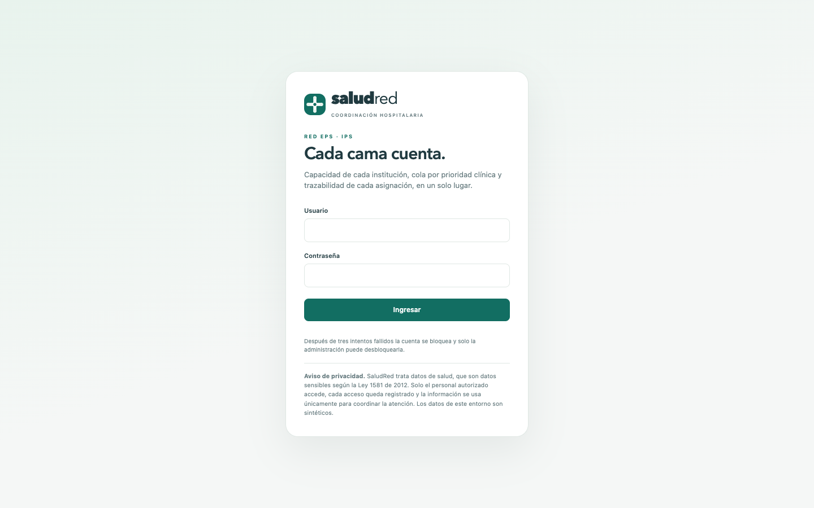 | 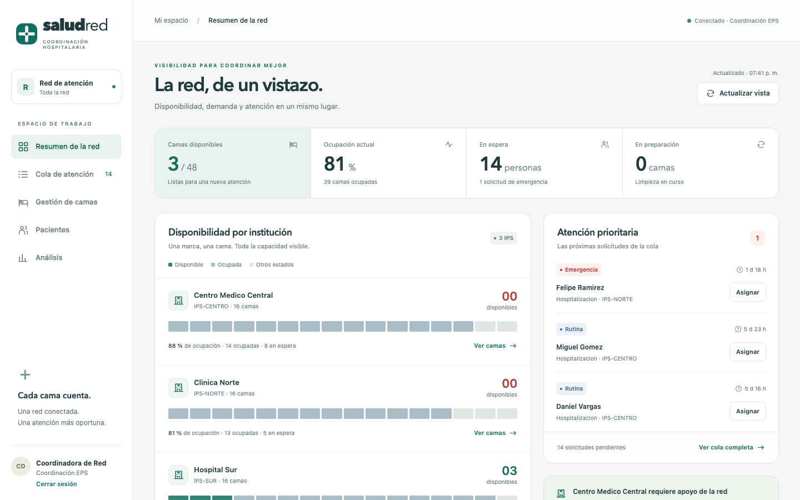 |
| **Inicio de sesión**, con el aviso de privacidad de la Ley 1581 de 2012 | **Resumen de la red**: camas por IPS y próximas solicitudes |
| 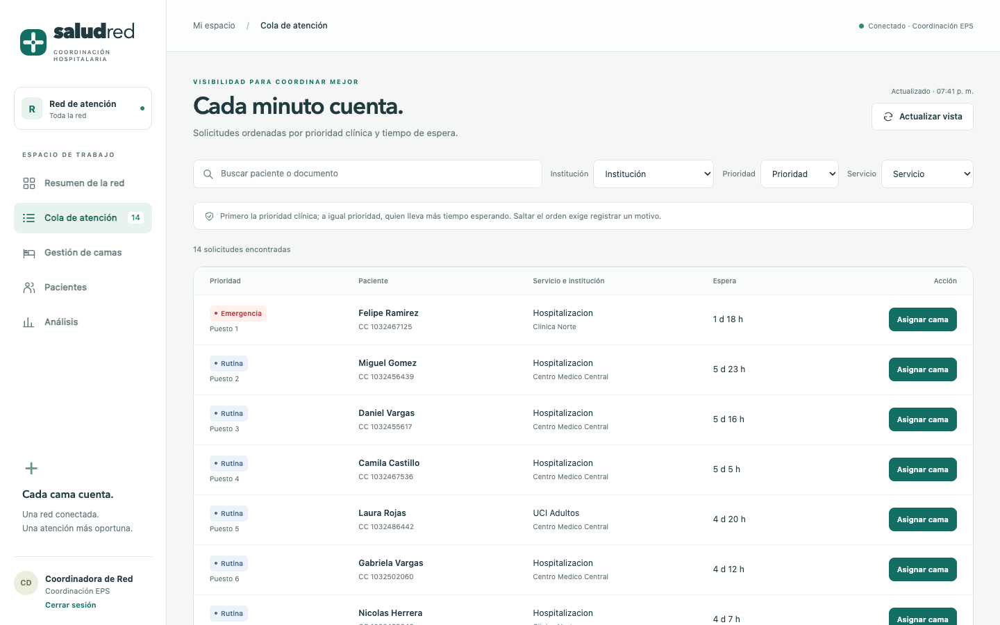 | 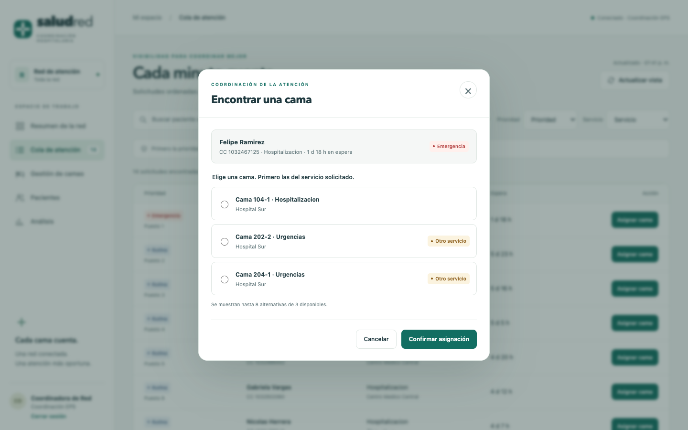 |
| **Cola de atención**, ordenada por prioridad clínica y tiempo de espera | **Asignar una cama**: primero las del servicio pedido |
| 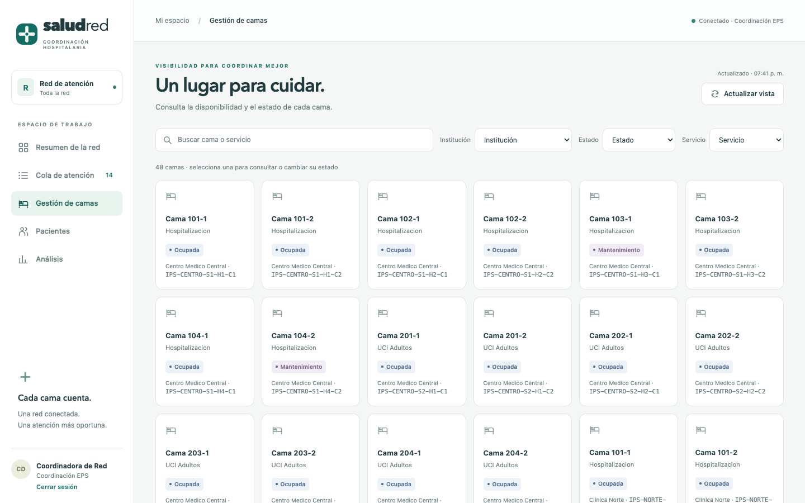 | 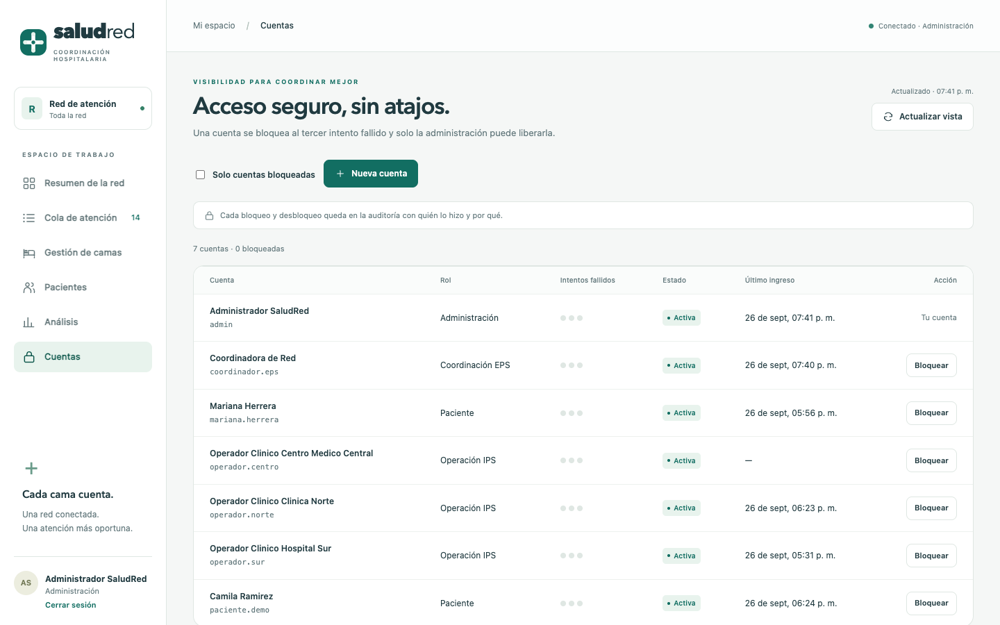 |
| **Gestión de camas**, con el estado de cada una | **Cuentas**: bloqueo por intentos fallidos y auditoría |
| 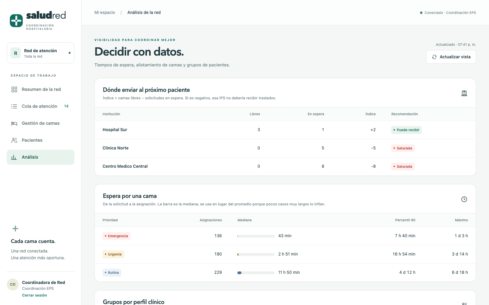 | 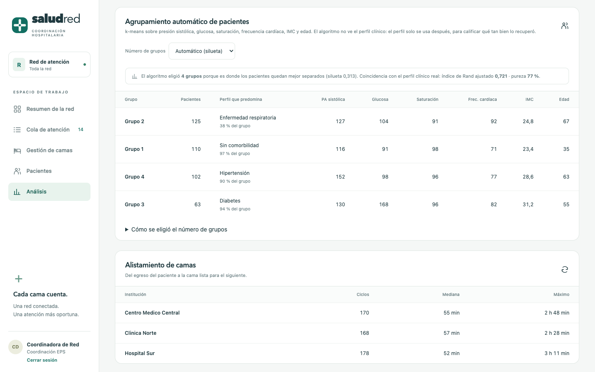 |
| **Análisis**: a qué IPS enviar al próximo paciente | **Agrupamiento k-means** calificado contra el perfil clínico |
| 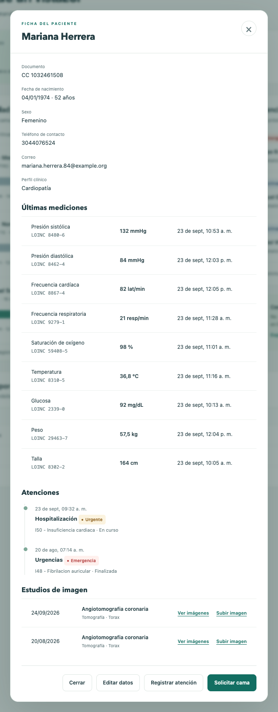 |  |
| **Ficha del paciente**: mediciones LOINC, atenciones y estudios | **Visor de imágenes** del PACS |
| 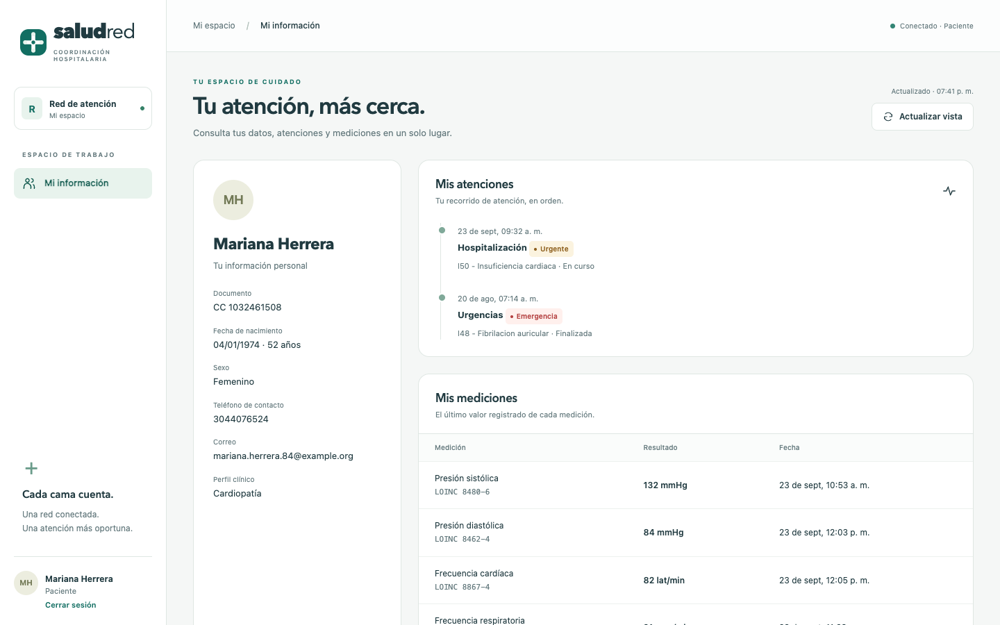 | |
| **Portal del paciente**: solo su propia información | |

## Seguridad

- Las credenciales se leen de variables de entorno; `.env` está excluido del control de versiones y
  `.env.example` documenta la forma de la configuración sin ningún valor real. Los secretos obligatorios no
  tienen valor por defecto: sin ellos el sistema no arranca.
- Las contraseñas se almacenan con **Argon2id** (`pwdlib`), nunca en texto plano. Los hashes bcrypt antiguos
  siguen sirviendo y se reescriben como Argon2id en el primer inicio de sesión correcto (`verify_and_update`).
- El JWT lleva solo el id y el rol más `iat`, `exp` (15 minutos), `iss` y `aud`; se acepta únicamente `HS256`
  (el algoritmo está fijo en el código, así que `alg: none` se rechaza). El rol se vuelve a leer de la base de
  datos en cada petición.
- **Cifrado de campos** (AES-256-GCM): documento, teléfono, correo y dirección del paciente se guardan como
  `v1.<kid>.<nonce>.<cifrado>`, con el id del paciente en los datos asociados (copiar el valor a otro paciente
  falla). Los datos clínicos quedan en claro. El documento se busca con un **índice ciego** (HMAC-SHA256 del
  documento normalizado, con una llave distinta): `1144-123-456` encuentra `1.144.123.456`. Sin llaves
  configuradas el sistema se comporta como antes.
- **Auditoría encadenada**: cada fila de `audit_log` guarda el hash de la anterior;
  `GET /api/v1/audit-logs/verify` (solo admin) recorre la cadena e informa la primera fila rota.
  Límite: borrar las últimas filas no se detecta, por eso `GET /api/v1/audit-logs/head` y
  `scripts/publicar_hash_auditoria.py` entregan el último hash para publicarlo cada día fuera de la base.
- Límite de tasa en FastAPI (ventana deslizante por IP): 10 peticiones cada 10 s en el inicio de sesión,
  `/oauth/token`, `/interop/*` y `/agente/*`, con un tope mayor configurable en el resto; el exceso recibe 429
  con `Retry-After`. `/health` y los canales en vivo no se limitan.
- `scripts/escanear_secretos.py` busca secretos en los archivos versionados y en `git log -p` (sin imprimir
  nunca el valor); `.env`, `pass.env`, `*.env` y `.env.bak*` están en `.gitignore`. Un secreto que llegó a un
  commit sigue en el historial: hay que **rotarlo**, no solo borrarlo.
- **Identidad de sistemas** (interoperabilidad con otros equipos, [`docs/INTEROP.md`](docs/INTEROP.md)):
  OAuth 2.0 *client credentials* (`POST /oauth/token`, token de 10 minutos con `aud` propio y solo los
  alcances registrados, distinto del JWT de usuario) y firma HMAC-SHA256 por mensaje con fecha, nonce de un
  solo uso y cuerpo (401 firma o fecha, 409 repetido). El paciente viaja como identificador federado, no como
  documento.
- La autorización se resuelve en el backend por rol, por institución y por pertenencia del registro. Un
  endpoint no se protege ocultándolo.
- Tres intentos fallidos bloquean la cuenta. Una cuenta bloqueada se rechaza **antes** de verificar la
  contraseña; un usuario inexistente recibe la misma respuesta que una contraseña incorrecta. Cada intento,
  bloqueo y desbloqueo queda en la auditoría y el bloqueo avisa al administrador.
- nginx limita la tasa (429) para lo que entra por el contenedor `web`, y envía una `Content-Security-Policy` y
  cabeceras de seguridad; CORS permanece cerrado salvo que se configuren orígenes. Detrás de nginx todos los
  clientes comparten la dirección del contenedor salvo que `TRUST_CF_CONNECTING_IP=true` (solo seguro si la API
  no es alcanzable directo): ajuste `RATE_LIMIT_GENERAL_MAX_REQUESTS` si hace falta.
- Al servicio de IA solo llegan variables clínicas y un seudónimo; MongoDB no guarda datos personales.

### Mapa normativo (R22)

Cada control responde a una norma. El detalle (archivo, endpoint y prueba de cada control) está en
[`docs/NORMATIVA.md`](docs/NORMATIVA.md). Las filas marcadas con * siguen la diapositiva 22 del profesor y no se
contrastaron con el texto oficial.

| Control | Norma |
|---|---|
| Hash (Argon2id), bloqueo, JWT y roles | Ley 1581 de 2012, art. 4 lit. g (principio de seguridad) y art. 17 lit. d (deber de conservar la información con seguridad)* |
| Seudonimización hacia la IA | Ley 1581 de 2012, art. 4 lit. b (finalidad) y f (acceso y circulación restringida) |
| Cifrado de campos e índice ciego | Ley 1581 de 2012, arts. 5 y 6 (los datos de salud son sensibles)* |
| Auditoría encadenada | Resolución 1995 de 1999 (integridad y custodia de la historia clínica)* |
| Perfil FHIR común | Ley 2015 de 2020 y Resolución 866 de 2021 (historia clínica interoperable) |
| Incidentes de seguridad | Reporte a la SIC dentro de los 15 días hábiles siguientes a la detección* |
| Acceso abusivo a sistemas | Ley 1273 de 2009, arts. 269A y 269F (delitos informáticos)* |

Notas: hay un proyecto de reforma parcial a la Ley 1581 radicado en el Congreso; mientras no se apruebe, rige la
Ley 1581 (verificar su estado antes de sustentar). La Resolución 2654 de 2019 (telesalud) aplica cuando una remisión
entre instituciones implica atención a distancia; la Resolución 3100 de 2019 rige la habilitación de servicios.

La correspondencia completa con la Ley 1581 de 2012, la Ley 2015 de 2020 y las resoluciones 866 de 2021, 1888 de
2025, 1995 de 1999 y 3100 de 2019 está en [`docs/NORMATIVA.md`](docs/NORMATIVA.md).

## Estado y limitaciones

Prototipo académico funcional. Limitaciones principales (detalle en [`docs/IA.md`](docs/IA.md) y
[`docs/NORMATIVA.md`](docs/NORMATIVA.md)):

- El modelo de criticidad es modesto (AUC 0,623 sobre 192 visitas reales de un solo hospital); es un apoyo que
  un clínico firma, no un diagnóstico.
- Los túneles rápidos de Cloudflare no entregan SSE (el canal público es WebSocket) y cambian de URL en cada
  reinicio.
- HAPI 7.4 entrega las suscripciones con una tarea de 5 s.
- El cifrado de campos está implementado, pero los datos que ya existen en la base compartida siguen en claro
  hasta que se apruebe y ejecute el relleno (`scripts/cifrar_pacientes.py`). OAuth2 de sistema existe solo para
  el intercambio entre equipos (`client credentials`, sin SMART Backend Services con llave privada); no hay
  escalado a varias réplicas de la API (el límite de tasa y el bloqueo de IP viven en el proceso).
- Los tokens duran 15 minutos y la interfaz no los renueva: al vencer pide iniciar sesión de nuevo.
- La demostración cruzada con otro equipo (R33) **no está hecha**: el socio no está asignado. La remisión de ida y
  vuelta (R30) se probó con SaludRed como su propio socio; el contrato con un equipo real (firma e identificador
  federado) sigue siendo configurable.
- Un rechazo por validación (nuestro receptor o el del socio) queda en la auditoría y en el estado de la remisión,
  pero no publica un aviso en vivo ([`docs/EVENTOS.md`](docs/EVENTOS.md)).
- La detección de prompt injection es por patrones y su bloqueo temporal vive en la memoria del proceso; la barrera
  real es el backend y la aprobación humana ([`docs/AGENTE.md`](docs/AGENTE.md)).
- No hay despliegue en un servidor gratuito: el sistema se publica por túneles rápidos de Cloudflare, cuyas URL
  cambian en cada reinicio.

## Licencia

Uso académico.
