# SaludRed — Coordinación de camas hospitalarias en red EPS/IPS

SaludRed es un sistema de gestión y asignación de camas para una EPS que coordina varias IPS.
Combina una API REST (FastAPI), una interfaz web por rol (React), analítica de la red, un servicio de
inteligencia artificial con firma clínica, facturación en MongoDB e interoperabilidad con HL7 FHIR R4.
Es un sistema activo: los hechos relevantes (una alerta crítica, una remisión, una factura, un resultado
de laboratorio externo) llegan a quien corresponde en segundos, sin recargar la página.

Proyecto del curso «Sistemas en Salud Digital». Todos los datos de la red son sintéticos o provienen de
conjuntos públicos con licencia abierta ([`docs/DATASETS.md`](docs/DATASETS.md)).

## Contenido

1. [El problema](#el-problema)
2. [Arquitectura](#arquitectura)
3. [Diagrama de servicios](#diagrama-de-servicios)
4. [Diagrama de eventos](#diagrama-de-eventos)
5. [Stack](#stack)
6. [Mapa de requisitos R01–R22](#mapa-de-requisitos-r01r22)
7. [Puesta en marcha y despliegue](#puesta-en-marcha-y-despliegue)
8. [Pruebas](#pruebas)
9. [Autenticación, roles y usuarios de prueba](#autenticación-roles-y-usuarios-de-prueba)
10. [Modelo de datos](#modelo-de-datos)
11. [Datos y licencias](#datos-y-licencias)
12. [Documentación](#documentación)
13. [Seguridad](#seguridad)
14. [Estado y limitaciones](#estado-y-limitaciones)

## El problema

La información sobre ocupación, altas, limpieza, bloqueos y disponibilidad de camas está fragmentada y se
actualiza tarde. La consecuencia no es necesariamente falta de camas: puede existir capacidad física
suficiente, pero si el estado de una cama no se conoce a tiempo, esa cama no se puede usar.

Eso produce esperas para pacientes que requieren hospitalización, llamadas y verificaciones repetidas entre
áreas, información duplicada y ausencia de trazabilidad sobre quién cambió un dato y cuándo.

El sistema ataca cuatro puntos concretos:

| Principio | Qué significa en el sistema |
|---|---|
| Visibilidad | todos los actores autorizados consultan el mismo estado |
| Oportunidad | el cambio se registra cuando ocurre, no cuando alguien pregunta |
| Coordinación | solicitudes, asignaciones y estados se comparten entre IPS |
| Trazabilidad | cada cambio deja registro de qué cambió, cuándo y quién lo hizo |

Una EPS coordina una red de IPS. Cada IPS opera sedes, servicios, habitaciones y camas. El modelo es
jerárquico y autorreferenciado: incorporar una IPS nueva o una cama nueva es una inserción, nunca una
migración de esquema.

```
EPS
 ├── IPS Norte ── sede ── servicio ── habitación ── cama
 ├── IPS Sur   ── sede ── servicio ── habitación ── cama
 └── IPS Centro ─ sede ── servicio ── habitación ── cama
```

## Arquitectura

| Servicio | Rol | Exposición |
|---|---|---|
| `web` | nginx: sirve la SPA de React y hace de proxy inverso de `/api/`, `/health`, `/docs`. El navegador usa un solo origen, sin CORS. Aplica el límite de tasa y la `Content-Security-Policy`. Tiene ubicaciones dedicadas para el WebSocket y el SSE, sin búfer. | Puerto 8081 |
| `api` | FastAPI: autenticación JWT, control de acceso por rol, institución y pertenencia, operaciones lógicas (editar, borrar, restaurar), auditoría, bus de eventos, canal en vivo, sincronización con FHIR. Corre **un solo proceso** a propósito (el registro de conexiones en vivo vive en memoria). | Puerto 8000 |
| `ml` | Servicio de IA (FastAPI y scikit-learn) con dos modelos: criticidad del paciente y retraso de limpieza. No accede a la base de datos y rechaza campos fuera de su contrato. | Solo red interna |
| `mongo` | MongoDB 7: colección `facturas` (contabilidad), sin datos personales. | Solo red interna |
| `hapi` | Servidor HAPI FHIR R4 v7.4.0. Avisa a la API mediante una `Subscription` rest-hook cuando llega una `Observation`. | Puerto 8080 |
| PostgreSQL de la aplicación | Fuente de verdad operativa y clínica. En el despliegue es una base gestionada en Neon; en desarrollo, el contenedor `db`. | `db`: puerto 5433 |
| PostgreSQL de HAPI | Base propia del servidor FHIR, separada de la de la aplicación. En el despliegue es una base en Neon; en desarrollo, el contenedor `hapi-db`. | Solo red interna |
| `tunnel-web`, `tunnel-api`, `tunnel-fhir` | Túneles rápidos de Cloudflare (`cloudflared`, arrancan con el mismo `up -d`) que publican la interfaz, la API y el servidor FHIR con URL HTTPS. | Conexión saliente |
| `orthanc` | Servidor PACS con los píxeles de las imágenes. El navegador nunca le habla: toda imagen pasa por la API. | `127.0.0.1:8042` |

Decisiones que conviene conocer:

- **Dos bases, dos ciclos de vida.** La aplicación es dueña del modelo operativo; HAPI es dueño de la
  representación interoperable. Compartir una sola base acoplaría nuestras migraciones al esquema interno de HAPI.
- **PostgreSQL para lo clínico y MongoDB para lo financiero.** El contable no ve nada clínico y el médico no ve
  nada financiero; dos bases hacen esa separación física. Ver [`docs/CONTABILIDAD.md`](docs/CONTABILIDAD.md).
- **El PACS guarda los píxeles; la base guarda los metadatos** de cada estudio de imagen. La API valida el token
  y el rol antes de servir cualquier imagen y deja rastro en la auditoría.
- **El servicio `ml` está aislado:** sin puertos publicados y sin acceso a la base. La API le entrega solo
  variables clínicas minimizadas y un seudónimo ([`docs/IA.md`](docs/IA.md)).

## Diagrama de servicios

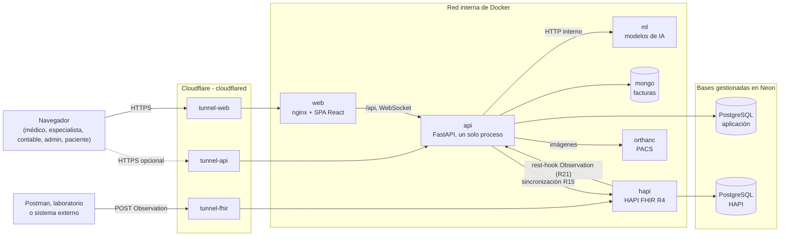

## Diagrama de eventos

El bus de eventos (`app/events/`) publica un hecho de dominio después del commit y los reactores (notificar,
facturar, alertar, contar) reaccionan sin que ningún endpoint los conozca. El catálogo completo está en
[`docs/EVENTOS.md`](docs/EVENTOS.md).

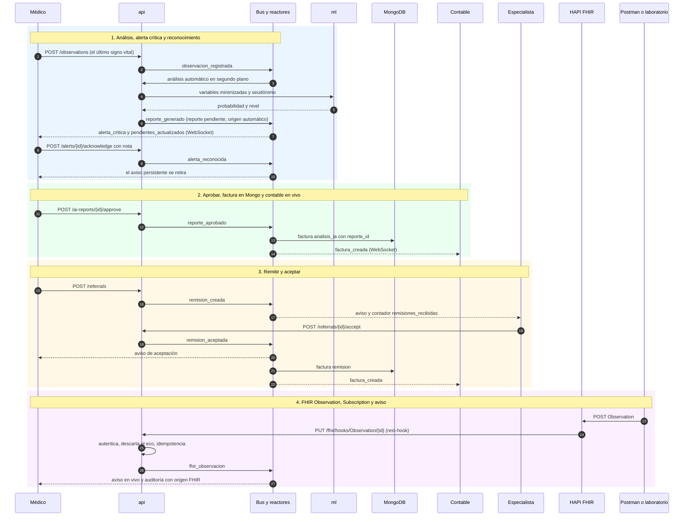

HAPI 7.4 entrega las suscripciones con una tarea programada de 5 s, así que el paso 4 tarda entre 5 y 9 s;
los demás flujos llegan en 2 a 5 s.

## Stack

| Componente | Tecnología |
|---|---|
| Base de datos | PostgreSQL (16 en contenedor, Neon en despliegue) |
| API | Python 3.12 · FastAPI · SQLAlchemy 2 · Pydantic v2 |
| Migraciones | Alembic |
| Autenticación | JWT (HS256) · hashing bcrypt |
| Interoperabilidad | HAPI FHIR R4 (v7.4.0) |
| Imágenes médicas | Orthanc (PACS DICOM) |
| Contabilidad | MongoDB 7 · pymongo |
| Inteligencia artificial | Servicio `ml` (FastAPI · scikit-learn, regresión logística) |
| Tiempo real | WebSocket (público) y Server-Sent Events (red local) |
| Interfaz | React 18 · TypeScript · Vite · PrimeReact sin estilos · Tailwind 3.4 · TanStack Query |
| Servidor web | nginx |
| Documentación de API | OpenAPI/Swagger generado por FastAPI (`/docs`) |

## Mapa de requisitos R01–R22

| Requisito | Dónde está implementado | Documento |
|---|---|---|
| R01 Múltiples roles | `app/core/authz.py`, `app/models/identity.py`, `app/api/routes/accounts.py` | [`docs/NORMATIVA.md`](docs/NORMATIVA.md) |
| R02 Bloqueo por intentos fallidos | `app/services/auth.py`, `app/api/routes/accounts.py` | [`docs/EVENTOS.md`](docs/EVENTOS.md) |
| R03 Seguridad de acceso | `app/core/security.py`, `app/main.py`, `frontend/nginx.conf`, `.gitignore` | [`docs/NORMATIVA.md`](docs/NORMATIVA.md) |
| R04 Sistema en línea por túnel | servicios `tunnel-*` de `docker-compose.yml`, `deploy/urls-publicas.*` | este README |
| R05 Todo dockerizado | `docker-compose.yml`, `Dockerfile`, `ml/Dockerfile`, `frontend/Dockerfile` | este README |
| R06 Imágenes reales | `scripts/load_chest_xrays.py`, `app/services/pacs.py`, `app/api/routes/imaging.py` | [`docs/DATASETS.md`](docs/DATASETS.md) |
| R07 Base tabular y aumento por grupos | `app/services/cohort_builder.py`, `scripts/build_cohort.py`, `GET /api/v1/cohort/clusters` | [`docs/DATASETS.md`](docs/DATASETS.md) |
| R08 Remisión entre médicos | `app/services/referrals.py`, `app/api/routes/referrals.py` | [`docs/EVENTOS.md`](docs/EVENTOS.md), [`docs/INTEROPERABILIDAD.md`](docs/INTEROPERABILIDAD.md) |
| R09 Contabilidad en MongoDB | `app/billing/`, `app/api/routes/billing.py` | [`docs/CONTABILIDAD.md`](docs/CONTABILIDAD.md) |
| R10 Reporte de IA con aprobación | `app/services/ai_reports.py`, `app/api/routes/ai.py` | [`docs/IA.md`](docs/IA.md) |
| R11 Historia clínica en PDF | `app/services/clinical_record.py`, `app/api/routes/clinical_record.py` | [`docs/IA.md`](docs/IA.md) |
| R12 Capa de seguridad hacia la IA | `app/services/pseudonymization.py`, `ml/` | [`docs/IA.md`](docs/IA.md) |
| R13 Auditoría | `app/services/trail.py`, `app/api/routes/audit.py` | [`docs/NORMATIVA.md`](docs/NORMATIVA.md) |
| R14 Borrado lógico y restauración | `app/services/soft_ops.py` | [`docs/modelo-datos-y-fhir.md`](docs/modelo-datos-y-fhir.md) |
| R15 Interoperabilidad FHIR | `app/fhir/`, `app/services/fhir_autosync.py`, `app/api/routes/integration.py` | [`docs/INTEROPERABILIDAD.md`](docs/INTEROPERABILIDAD.md) |
| R16 SPA reactiva | `frontend/` | [Desarrollo del frontend](#desarrollo-del-frontend) |
| R17 Canal en tiempo real | `app/events/channel.py`, `app/api/routes/events.py`, `frontend/nginx.conf` | [`docs/EVENTOS.md`](docs/EVENTOS.md) |
| R18 Bandeja y trabajo pendiente | `app/api/routes/notifications.py`, `app/services/pending.py`, `GET /api/v1/pendientes` | [`docs/EVENTOS.md`](docs/EVENTOS.md) |
| R19 Flujos automáticos | `app/events/`, `app/billing/reactors.py` | [`docs/EVENTOS.md`](docs/EVENTOS.md) |
| R20 Alertas críticas con reconocimiento | `app/services/alerts.py`, `app/services/alert_monitor.py`, `app/api/routes/alerts.py` | [`docs/EVENTOS.md`](docs/EVENTOS.md) |
| R21 Interoperabilidad reactiva | `app/api/routes/fhir_hooks.py`, `app/services/fhir_inbound.py`, `scripts/ensure_fhir_subscription.py` | [`docs/EVENTOS.md`](docs/EVENTOS.md) |
| R22 Documentación y sustentación | `docs/`, `tester.yaml` | [`docs/NORMATIVA.md`](docs/NORMATIVA.md), [`docs/IA.md`](docs/IA.md) |

El contrato de verificación automática está en [`tester.yaml`](tester.yaml).

## Puesta en marcha y despliegue

Único requisito: **Docker y Docker Compose**. No hace falta instalar Python ni dependencias en la máquina:
todo vive dentro de los contenedores.

### 1. Configuración

```bash
cp .env.example .env
```

Editar `.env`. El archivo `.env.example` lista todas las variables con su forma y sus valores por defecto;
**no se versiona ningún valor real**. Las variables **obligatorias** (sin valor por defecto) son:

| Variable | Uso |
|---|---|
| `JWT_SECRET_KEY` | firma de los tokens de sesión (mínimo 16 caracteres) |
| `PSEUDONYM_KEY` | clave HMAC del seudónimo que recibe la IA (mínimo 16 caracteres) |
| `FHIR_HOOK_SECRET` | clave compartida del rest-hook de HAPI (mínimo 16 caracteres) |
| `MONGO_ROOT_PASSWORD` | clave del usuario raíz de MongoDB; debe ser alfanumérica |

Para generar un valor aleatorio:

```bash
docker run --rm python:3.12-slim python -c "import secrets; print(secrets.token_urlsafe(48))"
```

Variables opcionales, solo por nombre (valores por defecto en `.env.example` y `app/core/config.py`):
`DATABASE_URL`, `POSTGRES_USER`, `POSTGRES_PASSWORD`, `POSTGRES_DB`, `JWT_ALGORITHM`,
`ACCESS_TOKEN_EXPIRE_MINUTES`, `ENVIRONMENT`, `API_V1_PREFIX`, `SEED_ON_START`, `SEED_DEFAULT_PASSWORD`,
`FHIR_BASE_URL`, `FHIR_IDENTIFIER_SYSTEM`, `FHIR_REQUEST_TIMEOUT_SECONDS`, `FHIR_AUTO_SYNC`,
`FHIR_HOOK_ENDPOINT`, `HAPI_DATABASE_URL`, `HAPI_DATABASE_USER`, `HAPI_DATABASE_PASSWORD`,
`ORTHANC_URL`, `ORTHANC_USER`, `ORTHANC_PASSWORD`, `ORTHANC_TIMEOUT_SECONDS`, `ML_SERVICE_URL`,
`MONGO_ROOT_USER`, `MONGO_DB`, `CORS_ALLOWED_ORIGINS`, `REQUIRE_CLEANING_EVIDENCE`,
`ALERT_ESCALATION_ENABLED`, `ALERT_ESCALATION_MINUTES`, `ALERT_MONITOR_INTERVAL_SECONDS`,
`BED_CLEANING_ALERT_MINUTES`, `AI_AUTO_ANALYSIS`, `AI_AUTO_GRACE_SECONDS`, `REQUIRE_REVIEW_NOTE` y `LOG_LEVEL`.

Si el despliegue usa una base gestionada (Neon), definir `DATABASE_URL` con el prefijo
`postgresql+psycopg://` y `?sslmode=require`; para HAPI, `HAPI_DATABASE_URL` en formato JDBC. Con bases
gestionadas, los contenedores `db` y `hapi-db` quedan sin uso.

### 2. Levantar los servicios

```bash
docker compose up -d --build     # TODO: db, api, ml, mongo, web, hapi, hapi-db, orthanc y los tres túneles
```

Un solo `docker compose up -d` levanta **todo**: API, PostgreSQL, MongoDB, servidor FHIR, PACS (Orthanc), servicio
de IA (`ml`), interfaz web (nginx) y `cloudflared` (`tunnel-web`, `tunnel-api`, `tunnel-fhir`). El archivo no usa
perfiles (`profiles`) y una prueba (`tests/test_deploy_constraints.py`) lo exige. La API no espera a Orthanc: solo
le habla cuando se pide una imagen. Cada túnel espera a que su destino esté sano. Las URL públicas se leen de los
registros de los túneles (`docker compose logs tunnel-web | findstr trycloudflare`) y cambian en cada reinicio.

Al construirse, el servicio `ml` entrena sus modelos con los CSV de `ml/data`. El servidor FHIR tarda entre 30 y
60 segundos en el primer arranque; está listo cuando `curl http://localhost:8080/fhir/metadata` responde.

### 3. Qué ocurre al arrancar la API

El `ENTRYPOINT` (`docker/entrypoint.sh`) espera a que PostgreSQL acepte conexiones, **aplica las migraciones**
(`alembic upgrade head`) y, solo si `SEED_ON_START=true`, carga los datos sintéticos (se omite solo si la base
ya tiene datos). Después arranca `uvicorn`, que inicializa los índices de MongoDB y el monitor de alertas.
Reiniciar el contenedor nunca duplica ni borra información.

### 4. Pasos posteriores al primer despliegue

1. **Crear la `Subscription` de FHIR** (R21), una vez que HAPI esté disponible y cada vez que cambie
   `FHIR_HOOK_SECRET`. Es idempotente:

   ```bash
   docker compose exec api python -m scripts.ensure_fhir_subscription
   ```

   También existe `POST /api/v1/integration/fhir/subscription` (solo admin). Debe quedar en estado `active`.
2. **Reenviar a HAPI los pacientes pendientes** (opcional): `POST /api/v1/integration/fhir/retry-failed`
   (solo admin), en lotes pequeños y de a uno.
3. **Conciliar la facturación** (opcional): `POST /api/v1/facturas/reconciliar` (admin o contable) crea las
   facturas que falten. Es idempotente; la primera vez recorre todo el historial y puede tardar más que el
   límite del túnel (100 s). Conviene ejecutarla por la red local.

### 5. URLs públicas de los túneles

Los túneles rápidos de Cloudflare **cambian de URL en cada reinicio** de los contenedores o de Docker. Se
leen de sus registros:

```bash
# Linux y macOS
bash deploy/urls-publicas.sh

# Windows (Bypass afecta solo a esta invocación)
powershell -ExecutionPolicy Bypass -File .\deploy\urls-publicas.ps1

# O directamente, servicio por servicio
docker compose logs tunnel-web  | grep trycloudflare
docker compose logs tunnel-api  | grep trycloudflare
docker compose logs tunnel-fhir | grep trycloudflare
```

El servidor FHIR sirve bajo `/fhir`, así que su CapabilityStatement queda en `<URL de FHIR>/fhir/metadata`.
Antes de una evaluación hay que actualizar la URL pública en [`tester.yaml`](tester.yaml).

### 6. Accesos locales

| Servicio | URL |
|---|---|
| Interfaz web | http://localhost:8081 |
| API | http://localhost:8000 |
| Swagger | http://localhost:8000/docs |
| HAPI FHIR | http://localhost:8080/fhir |
| PostgreSQL (contenedor `db`) | `localhost:5433` |

Comandos útiles:

```bash
docker compose logs -f api        # seguir el arranque
docker compose down               # detener
docker compose down -v            # detener y borrar los datos (incluye las imágenes del PACS)
```

### Desarrollo del frontend

Se necesita **Node 22.12 o posterior**:

```bash
cd frontend
npm ci
npm run dev
```

Vite sirve la interfaz en `http://localhost:5173` y reenvía `/api` a `http://localhost:8000`. En despliegue, el
contenedor `web` compila con Node y sirve `dist/` con nginx.

### PACS de imágenes (opcional)

Orthanc queda solo dentro de la red de Docker, con autenticación propia y el puerto 8042 publicado únicamente
en `127.0.0.1`. Su estado se consulta en `GET /health/pacs`; si está apagado, la historia clínica sigue
funcionando.

| Ruta | Qué hace |
|---|---|
| `POST /api/v1/imaging-studies/{id}/images` | Sube el archivo como cuerpo de la petición (DICOM, PNG o JPEG) al estudio ya registrado |
| `GET /api/v1/imaging-studies/{id}/images` | Lista las imágenes del estudio en el PACS |
| `GET /api/v1/imaging/instances/{id}/preview` | Vista previa PNG, con la misma regla de acceso que la ficha |

## Pruebas

Todas las pruebas se ejecutan **dentro de contenedores**; no hace falta instalar nada en el anfitrión.

```bash
# API (SQLite en memoria, sin tocar la base real). Las dos variables evitan que el
# entorno del contenedor en ejecución cambie el comportamiento esperado por las pruebas.
docker compose exec -T -e ALERT_ESCALATION_ENABLED=false -e REQUIRE_CLEANING_EVIDENCE=false api python -m pytest tests -q

# Servicio ml
docker run --rm -v "$PWD/ml:/srv/ml" -w /srv/ml python:3.12-slim \
  sh -c "pip install -q -r requirements-dev.txt && python -m pytest -q"

# Frontend: lint, pruebas y compilación
docker run --rm -v "$PWD/frontend:/app" -w /app node:22-alpine \
  sh -c "npm ci && npm run lint && npm test && npm run build"
```

Verificaciones adicionales contra el sistema en ejecución:

```bash
docker compose exec api python -m scripts.demo_join                # consulta JOIN de validación del modelo
docker compose exec api python -m scripts.smoke_api                # prueba de humo de la API
docker compose exec -e SMOKE_FHIR=1 api python -m scripts.smoke_api   # incluye la integración FHIR
```

Resultado de referencia (13/10/2026): 644 pruebas de la API, 39 del servicio `ml` y 274 del frontend, en verde.

## Autenticación, roles y usuarios de prueba

Todos los endpoints de `/api/v1` (salvo el login) exigen un token Bearer:

```bash
curl -X POST http://localhost:8000/api/v1/auth/login \
  -H "Content-Type: application/json" \
  -d '{"username": "admin", "password": "<contraseña de demo>"}'
```

En Swagger, el botón **Authorize** acepta el `access_token` devuelto. La contraseña de las cuentas de demo
se define en `SEED_DEFAULT_PASSWORD` (variable de entorno, ver `.env.example`).
Son cuentas sintéticas de desarrollo y no deben reutilizarse en un despliegue real.

| Rol del contrato | Cuenta de prueba | Qué puede hacer |
|---|---|---|
| `admin` | `admin` | todo; único que restaura registros, desbloquea cuentas, crea cuentas y consulta la auditoría |
| `coordinador` | `coordinador.eps` | lectura transversal de la red, gestión de solicitudes de cama y revisión de la limpieza |
| `medico` | `operador.norte`, `operador.sur`, `operador.centro` | crear pacientes, pedir camas, ejecutar y firmar la IA, remitir; solo en su IPS |
| `especialista` | `especialista.norte`, `especialista.sur` | recibir remisiones, ver la historia del paciente remitido, firmar reportes |
| `contable` | `contable.eps` | facturación de su EPS; no ve nada clínico |
| `paciente` | `paciente.demo` | solo su propia información |

Cuenta adicional `demo.bloqueo`: desechable, para mostrar el bloqueo tras tres intentos fallidos.

`especialista.sur` y `demo.bloqueo` no las crea el seed: las crea el administrador con
`POST /api/v1/admin/users`. Si se recarga la base con `--reset`, hay que crearlas de nuevo.

Operaciones de trazabilidad por entidad: `PUT` conserva la versión anterior (consultable en
`GET /{id}/history`), `DELETE` es lógico y `POST /{id}/restore` (solo admin) revierte la eliminación. La
bitácora completa se consulta en `GET /api/v1/audit-logs` (solo admin).

## Modelo de datos

Veintidós tablas relacionadas por llaves foráneas, agrupadas en bloques:

- **Red y ubicaciones:** `organizations`, `locations`
- **Identidad:** `roles`, `users`
- **Clínico:** `patients`, `encounters`, `observations`, `imaging_studies`, `referrals`
- **Coordinación de camas:** `bed_requests`, `bed_assignments`, `bed_status_events`, `bed_cleaning_records`
- **Inteligencia artificial y alertas:** `ai_reports`, `alerts`
- **Cohorte real y grupos:** `cohort_records`, `cohort_clusters`
- **Trazabilidad e interoperabilidad:** `record_versions`, `audit_log`, `fhir_sync_log`, `fhir_inbound_events`, `notifications`

Además, la vista SQL `v_inventario_camas` muestra una fila por cama con su IPS, servicio, estado y ocupante. La
facturación vive en MongoDB, no en estas tablas. El detalle, incluido el mapeo hacia FHIR, está en
[`docs/modelo-datos-y-fhir.md`](docs/modelo-datos-y-fhir.md); los diagramas, en [`docs/diagramas.md`](docs/diagramas.md).

Decisiones del esquema:

- **`deleted_at IS NULL` es la única fuente de verdad del borrado lógico.** No existe un `is_active` paralelo.
- **Los códigos que cruzan hacia FHIR se almacenan literales** (`in-progress`, `final`, `IMP`); el mapper no
  traduce vocabularios.
- **Las mediciones usan LOINC y UCUM**, con un rango fisiológicamente plausible por código.
- **Una cama solo puede tener una asignación activa**, garantizado por un índice único parcial en la base.

## Datos y licencias

Los datos de la red (pacientes, camas, solicitudes) son sintéticos y los genera `scripts/seed.py`. Los datos
reales provienen de conjuntos públicos con licencia abierta:

- **Tabular:** MIMIC-IV-ED Demo v2.2 (ODbL 1.0), con aumento por grupos.
- **Imagen:** NIH ChestX-ray14, subconjunto de adultos (60 radiografías cargadas en el PACS).
- **Limpieza de camas:** eventos simulados.

Fuentes, licencias, citas, número de registros y limitaciones: [`docs/DATASETS.md`](docs/DATASETS.md).

```bash
docker compose exec api python -m scripts.seed --reset                 # 16 pacientes para la demo
docker compose exec api python -m scripts.seed --reset --patients 400  # volumen para análisis
```

`--reset` borra todo el contenido de la base antes de cargar. Hay que respaldarla antes.

## Documentación

| Documento | Contenido |
|---|---|
| [`docs/NORMATIVA.md`](docs/NORMATIVA.md) | Norma, artículo o principio, control técnico y evidencia |
| [`docs/EVENTOS.md`](docs/EVENTOS.md) | Catálogo de eventos, canal en vivo, alertas, escalamiento y `Subscription` de FHIR |
| [`docs/IA.md`](docs/IA.md) | Seudonimización, firma clínica, modelos, umbrales y sesgo por subgrupo |
| [`docs/INTEROPERABILIDAD.md`](docs/INTEROPERABILIDAD.md) | Sincronización con HAPI, `Bundle`, `ServiceRequest` y marco normativo |
| [`docs/CONTABILIDAD.md`](docs/CONTABILIDAD.md) | Facturación en MongoDB: documentos, índices, flujos y conciliación |
| [`docs/DATASETS.md`](docs/DATASETS.md) | Conjuntos de datos, licencias, grupos y limitaciones |
| [`docs/modelo-datos-y-fhir.md`](docs/modelo-datos-y-fhir.md) | Modelo de datos y mapeo hacia FHIR |
| [`docs/diagramas.md`](docs/diagramas.md) | Diagramas de arquitectura, entidad-relación, sincronización y control de acceso |
| [`docs/postman/`](docs/postman/) | Colección de Postman de organizaciones (sin credenciales) |
| [`tester.yaml`](tester.yaml) | Contrato de verificación automática |

## Capturas

Las capturas de `docs/capturas/` corresponden a una versión anterior de la interfaz y se conservan como
referencia del flujo de camas. Todas usan datos sintéticos.

| | |
|---|---|
| 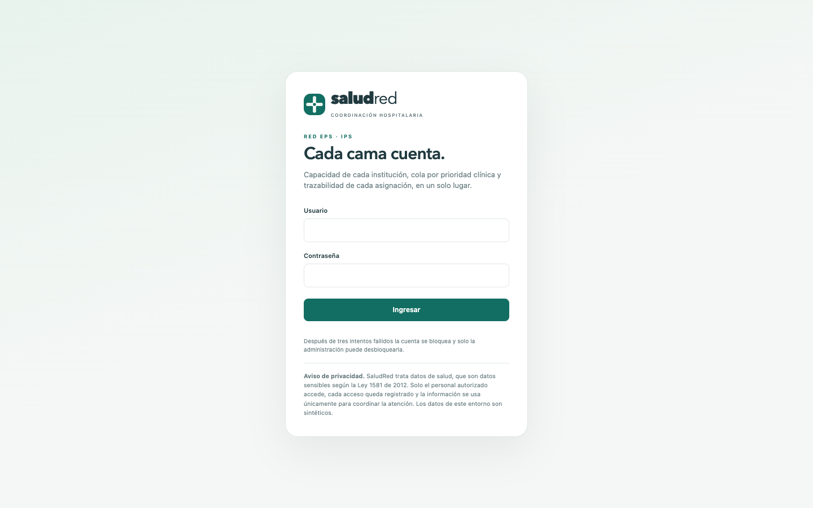 | 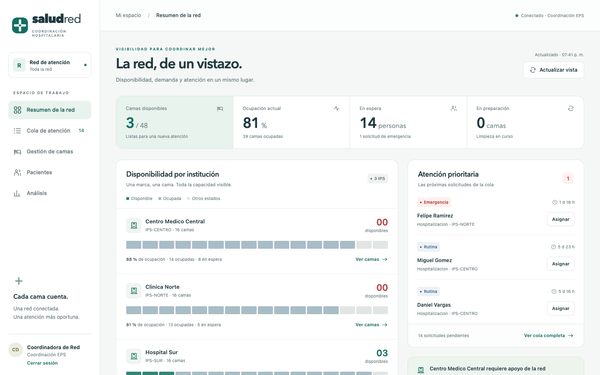 |
| **Inicio de sesión**, con el aviso de privacidad de la Ley 1581 de 2012 | **Resumen de la red**: camas por IPS y próximas solicitudes |
| 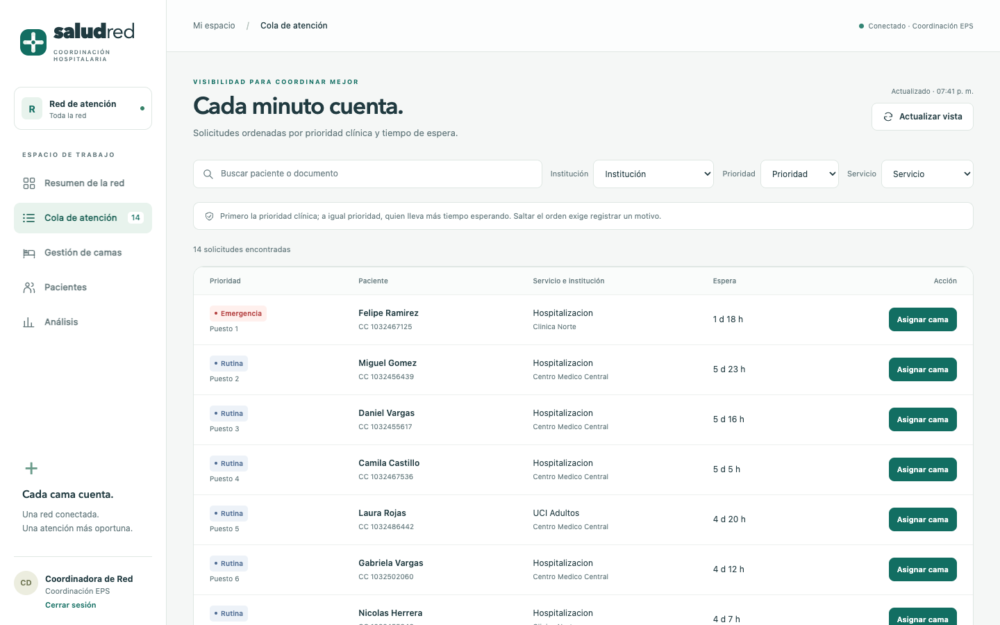 | 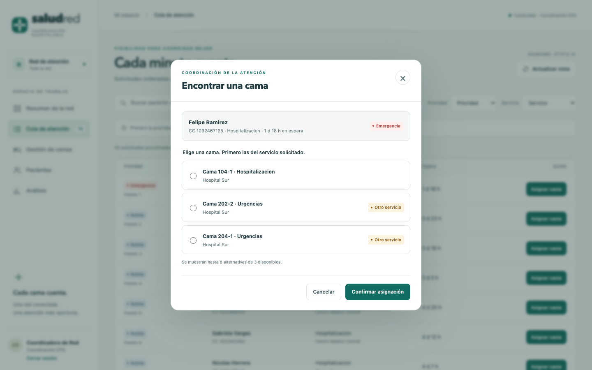 |
| **Cola de atención**, ordenada por prioridad clínica y tiempo de espera | **Asignar una cama**: primero las del servicio pedido |
| 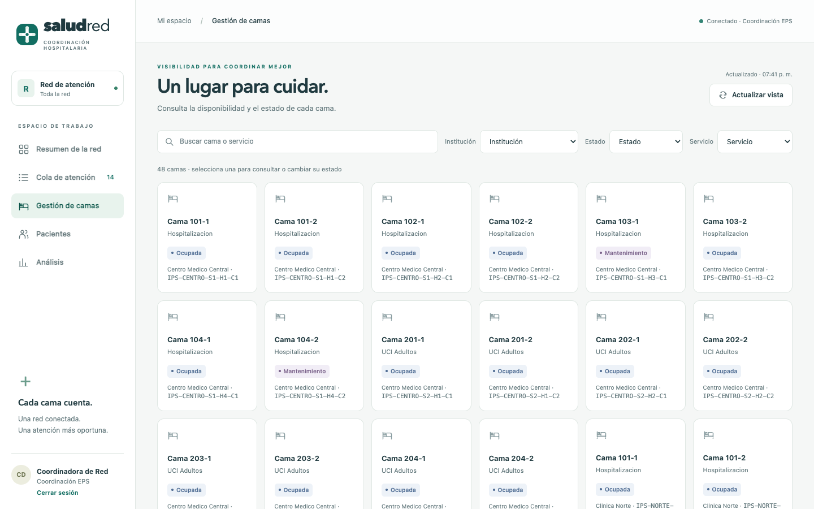 | 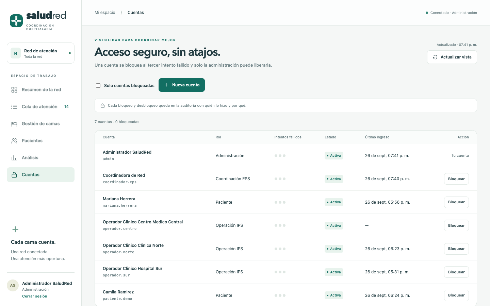 |
| **Gestión de camas**, con el estado de cada una | **Cuentas**: bloqueo por intentos fallidos y auditoría |
| 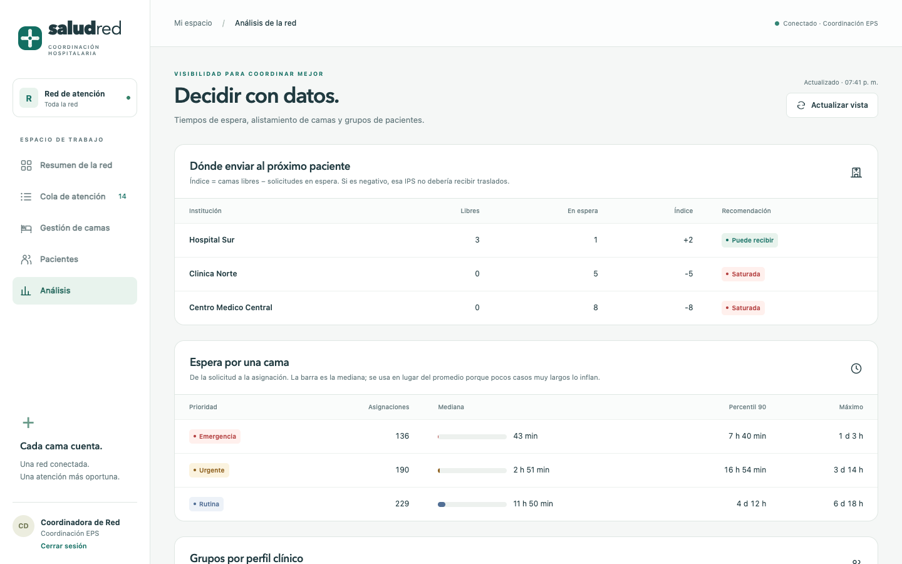 | 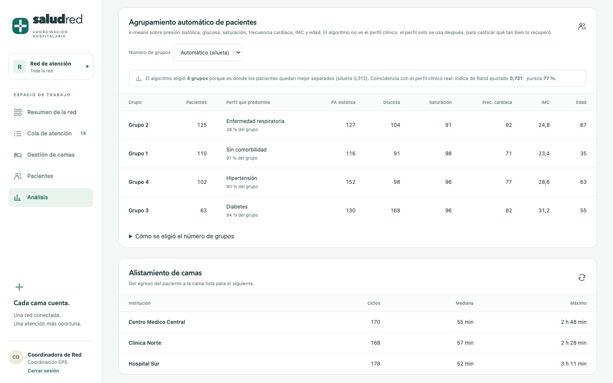 |
| **Análisis**: a qué IPS enviar al próximo paciente | **Agrupamiento k-means** calificado contra el perfil clínico |
| 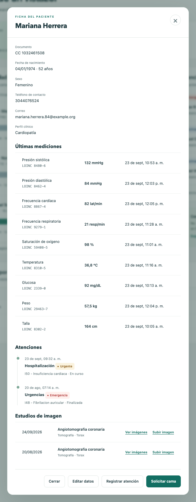 | 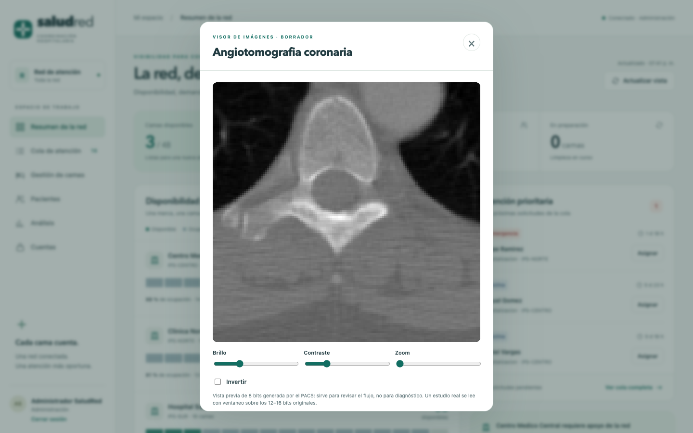 |
| **Ficha del paciente**: mediciones LOINC, atenciones y estudios | **Visor de imágenes** del PACS |
| 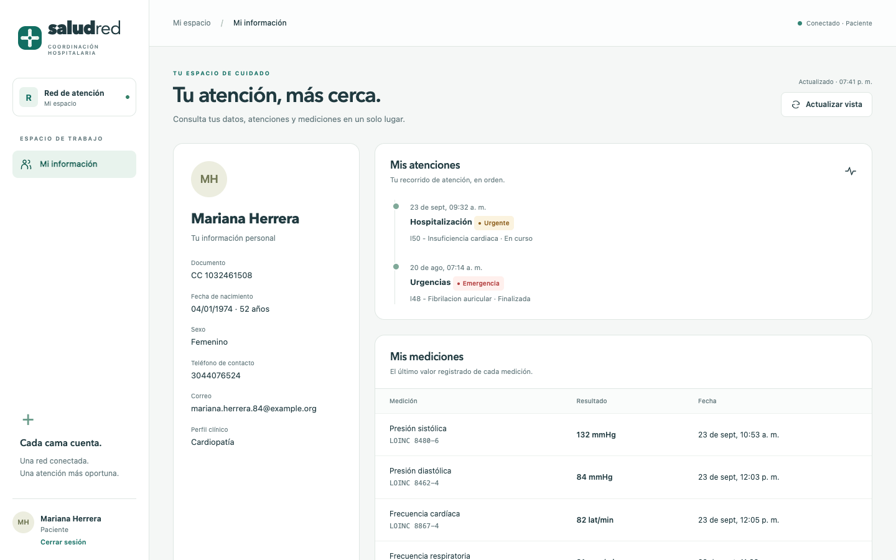 | |
| **Portal del paciente**: solo su propia información | |

## Seguridad

- Las credenciales se leen de variables de entorno; `.env` está excluido del control de versiones y
  `.env.example` documenta la forma de la configuración sin ningún valor real. Los secretos obligatorios no
  tienen valor por defecto: sin ellos el sistema no arranca.
- Las contraseñas se almacenan con bcrypt, nunca en texto plano.
- La autorización se resuelve en el backend por rol, por institución y por pertenencia del registro. Un
  endpoint no se protege ocultándolo.
- Tres intentos fallidos bloquean la cuenta. Una cuenta bloqueada se rechaza **antes** de verificar la
  contraseña; un usuario inexistente recibe la misma respuesta que una contraseña incorrecta. Cada intento,
  bloqueo y desbloqueo queda en la auditoría y el bloqueo avisa al administrador.
- nginx limita la tasa (429), envía una `Content-Security-Policy` y cabeceras de seguridad; CORS permanece
  cerrado salvo que se configuren orígenes.
- Al servicio de IA solo llegan variables clínicas y un seudónimo; MongoDB no guarda datos personales.

La correspondencia con la Ley 1581 de 2012, la Ley 2015 de 2020 y las resoluciones 866 de 2021, 1888 de 2025,
1995 de 1999 y 3100 de 2019 está en [`docs/NORMATIVA.md`](docs/NORMATIVA.md).

## Estado y limitaciones

Prototipo académico funcional. Limitaciones principales (detalle en [`docs/IA.md`](docs/IA.md) y
[`docs/NORMATIVA.md`](docs/NORMATIVA.md)):

- El modelo de criticidad es modesto (AUC 0,623 sobre 192 visitas reales de un solo hospital); es un apoyo que
  un clínico firma, no un diagnóstico.
- Los túneles rápidos de Cloudflare no entregan SSE (el canal público es WebSocket) y cambian de URL en cada
  reinicio.
- HAPI 7.4 entrega las suscripciones con una tarea de 5 s.
- No se implementa cifrado a nivel de campo, OAuth2/SMART on FHIR ni escalado a varias réplicas de la API.

## Licencia

Uso académico.
