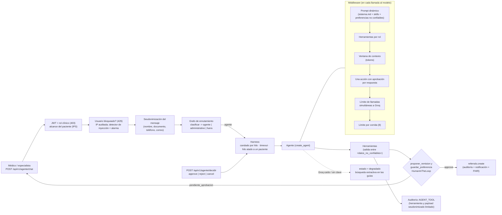
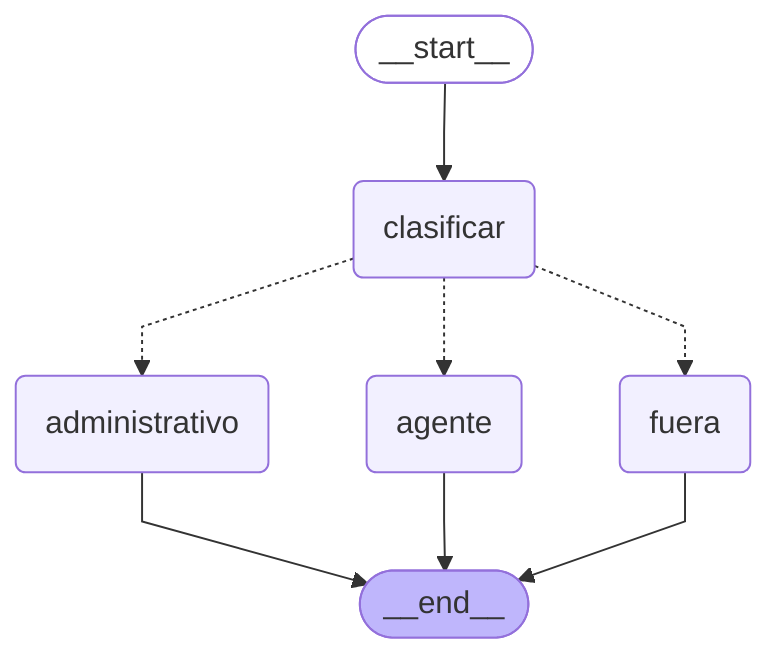

# Agente clínico (harness)

Un agente de LangChain (`create_agent`) que conversa con el médico o el especialista, consulta al paciente abierto y las guías del RAG, y **propone** una remisión que solo se crea cuando un clínico la aprueba. Sigue la regla del resto de la IA del proyecto ([`IA.md`](IA.md), [`RAG.md`](RAG.md)): **el sistema propone y un clínico decide**.

El modelo solo razona. Lo que puede ver, hacer y a nombre de quién lo decide el **harness** (código), no el prompt.

## Arquitectura



Memoria:

| Memoria | Qué guarda | Dónde |
|---|---|---|
| Corto plazo (checkpointer) | Mensajes del hilo `"<id del usuario>:<conversacion_id>"` y la pausa de aprobación | PostgreSQL de la aplicación (`checkpoints*`), memoria si no se puede abrir |
| Largo plazo (store) | Preferencias de estilo del usuario (`preferencias/<id>`, máximo 10, solo con aprobación), y por hilo: a qué paciente está atado y si hay una acción pendiente (`hilos`) | PostgreSQL (`store*`), memoria si no se puede abrir |

Las tablas `checkpoints*` y `store*` las crea la propia librería (`setup()` al arrancar la API); no pasan por Alembic. Con `AGENT_MEMORY=memory` (o si Postgres falla al arrancar) todo queda en proceso y se pierde al reiniciar: se registra en el log. Como la pausa de aprobación vive en el checkpointer, sobrevive a un reinicio solo con Postgres.

## Grafo de enrutamiento

Antes del agente hay un grafo de LangGraph explícito. El clasificador es **por reglas** (sin llamada extra a Groq) y su regla de seguridad es: **ante la duda, al agente**. Solo una pregunta claramente administrativa (facturas, citas, horarios, contraseñas, cuentas) o claramente ajena a la atención (fútbol, chistes, cocina...) y **sin vocabulario clínico** se responde con un texto fijo sin llamar al modelo. Si aparece cualquier término clínico (triage, paciente, cama, remisión, guía, convulsiones, código/clave roja...), gana el agente. Las listas son estrechas a propósito: «clave roja», «una serie de convulsiones» o «cítame la fuente» ya no caen en administrativo o fuera de tema (`tests/test_agent.py`, parámetros del clasificador). La auditoría registra la `ruta`; la respuesta solo la incluye en modo prueba (`AGENT_DEBUG`).



(Generado con `build_flow(...).get_graph().draw_mermaid()`; `tests/test_agent.py` comprueba que los cuatro nodos existen.)

## Endpoints

| Endpoint | Quién | Qué hace |
|---|---|---|
| `POST /api/v1/agente/inicio` | `medico`, `especialista` (otros: 403) | `{conversacion_id?, paciente_id?}`. Devuelve los **mensajes iniciales predefinidos** (`mensajes`, `atajos`) sin llamar al modelo: saludo con el nombre y el rol de la sesión, paciente abierto (solo el seudónimo) y atajos de preguntas. Se audita como `AGENT_CHAT` con `estado = inicio` |
| `POST /api/v1/agente/chat` | `medico`, `especialista` (otros: 403) | `{mensaje, conversacion_id?, paciente_id?}`. Responde `{estado, conversacion, fuentes, respuesta? \| acciones?}` |
| `POST /api/v1/agente/decidir` | `medico`, `especialista` (otros: 403) | `{conversacion_id, decision: approve\|reject\|cancel, motivo?}`. Reanuda el hilo pausado; `cancel` descarta la acción sin ejecutarla y libera el hilo |

`estado`: `inicio`, `respondido`, `pendiente_aprobacion` (con `acciones`: `accion` = `remision` \| `preferencia`, y el nombre del especialista, su IPS y el motivo, o el texto de la preferencia; sin nombres de herramienta ni ids), `degradado` (Groq no disponible: texto de las guías), `tiempo_agotado`, `decision_aplicada` (la decisión se ejecutó pero el modelo no pudo redactar el cierre).

**Respuesta limpia.** `conversacion` devuelve el `conversacion_id` enviado (no el UUID del usuario). La `respuesta` pasa por un filtro de salida (`presentation.clean_answer`) que quita UUID, nombres de herramientas y códigos como `SIN_EVIDENCIA:` (los traduce a frases). `ruta`, `motivo` y, en las acciones, `herramienta`/`args` solo viajan con `AGENT_DEBUG=true`.

**Fuentes (R23).** Cada `respuesta` lleva `fuentes`: documento, título, fragmento de hasta 400 caracteres, `chunk_id`, URL y orden `n`. Las citas del agente usan `[chunk_id]`, estable entre varias búsquedas; `n` solo ordena la lista. Se devuelve la evidencia consultada en el turno, sin duplicar fragmentos ni reutilizar fuentes de una pregunta anterior. `consultar_paciente` aporta la fuente `documento="historia"`, con `chunk_id="CTX-<seudónimo>"` y resumen seudonimizado. La abstención del backend se aplica cuando se realizó una búsqueda sin resultados y ninguna otra herramienta aportó datos. Los saludos y los rechazos de acceso conservan su respuesta. Los mensajes fijos y las abstenciones tienen fuentes vacías. El RAG conserva `answer`/`sources`, `doc_id`/`title` y añade `respuesta`/`fuentes`, `documento`/`titulo`, con `fragmento` en cada fuente nueva.

Errores: `403` rol no clínico o paciente fuera de la IPS; `404` paciente inexistente; `409` conversación atada a otro paciente, o `decidir` sin nada pendiente; `422` cuerpo inválido; `429` demasiados turnos en curso (`Retry-After: 5`) o usuario bloqueado temporalmente (`Retry-After` = segundos restantes). El bloqueo es por usuario; la IP se registra en la auditoría.

Reglas del hilo:

- `thread_id = "<id del usuario autenticado>:<conversacion_id>"`: un usuario nunca toca el hilo de otro.
- Un hilo queda **atado al paciente** con el que se abrió. Usarlo con otro paciente (o sin paciente) responde 409: así el historial de uno no entra al contexto de otro.
- Mientras hay una acción pendiente, el hilo no ejecuta mensajes nuevos.
- Un candado por hilo (misma conversación: una solicitud a la vez); hilos distintos corren en paralelo. Los candados ociosos se eliminan al terminar.
- **Una sola acción con aprobación por respuesta del modelo.** Si el modelo emite varias (`proponer_remision`, `guardar_preferencia`), el middleware `SingleGatedAction` conserva la primera y descarta el resto. Además `decidir` envía una decisión por cada acción que el hilo tenga pendiente, de modo que un hilo pausado con varias (de antes de esta regla) tampoco queda atascado, y `cancel` lo libera.
- **Turnos en vuelo acotados** (`AGENT_MAX_INFLIGHT_TURNS`, 8): el 9.º simultáneo recibe 429 en vez de encolarse sin límite.
- **La conexión de la petición se devuelve al pool antes de esperar al modelo** (`db.commit()` tras abrir el turno): un turno dura hasta 90 s y mientras tanto no retiene una conexión del pool (5+5). La auditoría final usa una transacción nueva y corta. Las herramientas siguen abriendo sus propias sesiones cortas.
- **Tiempo agotado conciliado con el checkpointer.** `asyncio.wait_for` cancela la espera, no el trabajo hecho. Tras el vencimiento se lee `aget_state`: si el hilo sigue esperando una decisión, se informa `pendiente_aprobacion`; si la aprobación ya se consumió, se baja la bandera `pendiente` y se responde `decision_aplicada`. Cada paso se guarda con `durability="sync"` para que ese estado sea fiable.
- **Remisión idempotente.** `proponer_remision` pasa a `referrals.create` la clave `<hilo>:<tool_call_id>` (columna `referrals.idempotency_key` con índice único parcial, migración `a2f7c4d19b60`): reintentar una aprobación que venció devuelve la misma remisión, sin fila, auditoría ni notificación nuevas. La base de datos lo garantiza aunque dos procesos se crucen.

## Herramientas

El paciente **nunca** es un argumento: lo fija el harness desde `paciente_id` y la IPS del usuario. Todas vuelven a comprobar identidad, rol y alcance al ejecutarse.

Las seis descripciones (lo que le dice al modelo *cuándo* y *cómo* usar cada una) siguen la misma forma: **Úsala cuando / No la uses cuando / Argumentos / Devuelve**; `tests/test_agent.py` comprueba que ninguna pierde una sección. La salida de `consultar_paciente` y `buscar_guias` llega envuelta en `<datos_no_confiables fuente="...">` (ver «Defensa en capas»).

| Herramienta | Qué hace | Roles | Aprobación |
|---|---|---|---|
| `consultar_paciente` | Seudónimo + edad, sexo y últimos signos vitales (`build_criticality_payload`) y el resumen clínico seudonimizado (`build_patient_context`), con el alcance por IPS / remisión | medico, especialista | No |
| `buscar_guias(pregunta)` | Recuperación híbrida del RAG (`retrieve`: BM25 + denso + RRF + MMR) sobre las guías y la historia **aprobada** del paciente abierto. Devuelve fragmentos `[chunk_id]` o `SIN_EVIDENCIA`. Sin modelo propio: el agente redacta | medico, especialista | No |
| `listar_especialistas` | Especialistas activos de la red con su `especialista_id` real | medico | No |
| `proponer_remision(especialista_id, motivo)` | Crea la remisión con `referrals.create` (reglas de R08, auditoría `REFERRAL_CREATED`, notificación al especialista, sincronización FHIR), de forma idempotente por (hilo, `tool_call_id`) | medico | **Sí** (`HumanInTheLoopMiddleware`: approve / reject / cancel) |
| `guardar_preferencia(preferencia)` | Guarda una **pista de estilo** en el store. Se limpia de identificadores, se recorta a 200 caracteres, se rechaza si menciona pacientes, un seudónimo, cifras largas o correos, o si el detector de inyección la marca; máximo 10 por usuario | medico, especialista | **Sí** (el clínico ve el texto antes de que se guarde) |
| `cargar_skill(nombre)` | Carga el procedimiento completo de una skill | medico, especialista | No |

Al especialista no se le ofrecen `proponer_remision` ni `listar_especialistas` (middleware por rol), y las herramientas lo vuelven a negar.

## Skills

Carpeta `app/services/agent/skills/<nombre>/SKILL.xml`. Solo el índice (`name` + `description`, una línea por skill) va en el prompt; el procedimiento se carga bajo demanda y se entrega al modelo como texto numerado.

```xml
<skill name="triage-criticidad" description="Cómo interpretar la criticidad...">
  <titulo>Interpretación de criticidad en urgencias</titulo>
  <paso n="1">Llame a `consultar_paciente` ...</paso>
  <paso n="2">...</paso>
  <nota>Opcional.</nota>
</skill>
```

El cargador usa `xml.etree.ElementTree` de la biblioteca estándar (el proyecto no depende de `defusedxml`; los archivos viajan con el código, no son entrada de usuarios). Un archivo que no parsea, con otra raíz, sin `description`, con nombre inválido, sin pasos o con un `paso` sin `n` se omite con un `WARNING` en el log; nunca tumba la API.

| Skill | Para qué |
|---|---|
| `triage-criticidad` | Interpretar la criticidad de un paciente de urgencias con sus signos vitales y las normas de triage |
| `remision-especialista` | Decidir y proponer una remisión: datos, guía, elección del especialista, motivo con cita |

`cargar_skill` usa el nombre solo como **clave de búsqueda** en el catálogo; además exige el patrón `^[a-z0-9][a-z0-9-]{0,63}$` y que la ruta resuelta quede dentro de la carpeta de skills. `../../app/main`, rutas absolutas y separadores devuelven `SKILL_NO_EXISTE`.

## Privacidad y auditoría

- **Mensaje del clínico:** antes de entrar al hilo se le quitan nombre, documento, teléfono, correo y dirección del paciente abierto (`privacy.scrub`, las mismas fuentes de verdad que el RAG). Limitación: lo que el clínico escribe sobre **otra** persona solo se limpia en lo que cubren las expresiones regulares (`CC ...`, celulares, correos); el sistema no puede conocer el nombre de un paciente que no abrió.
- **Hacia el modelo** viajan el seudónimo `pz-...`, variables clínicas y texto limpio. El resultado de cada herramienta vuelve a limpiarse antes de entregarlo al modelo y al checkpointer. Los identificadores de paciente no se envían; los de especialistas y remisiones sí se usan para ejecutar acciones. El filtro de domicilio reconoce la dirección registrada con variaciones de puntuación y, sin paciente, patrones de calle con `#`, `No.`, `n°` y «número».

- **Payload de herramienta (R24):** `AGENT_TOOL.metadata.payload_llm.enviado_al_llm` guarda el prefijo exacto del resultado ya limpio, hasta 3000 caracteres; `truncado` indica si se cortó. Los argumentos del modelo no se copian (solo sus nombres). Se auditan también errores, con resultado vacío cuando la herramienta no devolvió nada. Es evidencia de la salida entregada al harness, no del prompt completo ni de que Groq alcanzara a recibirla. Las pruebas comparan ese payload con las entradas del modelo falso y comprueban que no contienen canarios.
- **Motivo del rechazo:** lo que el clínico escribe al rechazar también se limpia (con la identidad del paciente del hilo) antes de llegar al modelo y al checkpoint.
- **Auditoría** (`audit_log`; acciones del agente por la migración `d3a8f2c91b47`, y `AGENT_SECURITY_EVENT` / `IP_BLOCKED` por `a2f7c4d19b60`): `AGENT_CHAT` (estado, ruta, longitud del mensaje, `alerta`/`bloqueo` si los hubo y `payload_llm` con el mensaje seudonimizado entregado al flujo: `enviado_al_llm` hasta 3000 caracteres y `truncado`), `AGENT_TOOL` (herramienta, nombres de los argumentos, estado, `chunk_ids`, `referral_id`, `payload_llm`), `AGENT_DECISION` (approve / reject / cancel, **con el paciente del hilo**), `AGENT_SECURITY_EVENT` e `IP_BLOCKED`. La remisión además deja su propio `REFERRAL_CREATED`. Estas filas llenan `audit_log.ip_address` con la IP del llamante (`app.core.net.client_ip`). El payload registra la entrada del flujo; las rutas de respuesta fija no llaman al LLM.

## Defensa en capas contra la inyección («El modelo cae. La arquitectura no.»)

El detector es una alarma; las barreras reales son el código y la aprobación humana.

| Capa | Qué hace | Dónde |
|---|---|---|
| 1. Delimitar | La salida de `consultar_paciente` (resumen clínico) y de `buscar_guias` (fragmentos del RAG) va entre `<datos_no_confiables fuente="...">…</datos_no_confiables>`; una etiqueta de apertura o cierre dentro del contenido se neutraliza (`&lt;`) y el prompt explica qué significa la etiqueta. Las preferencias guardadas van entre `<preferencias_estilo_no_confiables>` con la misma regla | `guard.py`, `tools.py`, `prompt.py`, `sistema.md` |
| 2. Detector | Las 4 expresiones de la diapositiva 17 (ignorar instrucciones, cambiar el rol, ordenar herramientas, sacar datos por correo/URL), sobre texto sin acentos; 1 acierto = nivel `medio`, 2 o más = `alto`. Se aplica al mensaje del clínico y a lo que traen las herramientas. **No bloquea el turno**: lo registra | `guard.py` |
| 3. Política en código | El paciente sale de la sesión, nunca de un argumento (ninguna herramienta lo recibe: lo comprueba una prueba); herramientas por rol; cada herramienta vuelve a validar | `tools.py`, `context.py` |
| 4. Aprobación humana | Remisión y preferencia esperan al clínico; una sola por respuesta del modelo | `harness.py` |

**Registros.** En modo normal hay dos: el de errores (`app.services.agent.*`) y el de eventos de seguridad, logger `app.security`, una línea por evento: `evento_de_seguridad tipo=… nivel=… fuente=… usuario=… ip=… accion=… patrones=…` (la hora la pone el formato del log). Cada evento es también una fila `AGENT_SECURITY_EVENT` con la IP. Tipos: `inyeccion_en_mensaje`, `inyeccion_en_herramienta`, `fuera_de_alcance`. **El texto del mensaje nunca se registra.** El detalle de cada turno (herramientas, estados) solo se escribe con `AGENT_DEBUG=true`.

**Bloqueo temporal (por usuario).** Cada hallazgo `alto` en el mensaje del clínico, y cada respuesta fija «fuera de alcance», suma un intento al **usuario autenticado** (revisión independiente, hallazgo 3: detrás de nginx o del túnel varios clínicos comparten la dirección del socket, y bloquear por IP dejaría fuera a toda la clínica por el abuso de uno; la IP sigue en la fila de auditoría y en el log de seguridad; la clase es `security.StrikeBlockList`); al llegar a `AGENT_IP_BLOCK_STRIKES` (3) dentro de la ventana de `AGENT_IP_BLOCK_MINUTES` (15) el usuario queda bloqueado en `/api/v1/agente/*` durante esos minutos (429 con `Retry-After`), con una fila `IP_BLOCKED` y un evento. Un hallazgo de nivel `medio`, o uno que viene de una herramienta (el clínico no lo escribió), se registra pero no suma. `AGENT_IP_BLOCK_MINUTES=0` desactiva el bloqueo. La lista vive en el proceso (la API corre con un solo worker) y se pierde al reiniciar.

**IP real.** `client_ip(request)` (`app/core/net.py`) usa la dirección del socket; solo con `TRUST_CF_CONNECTING_IP=true` usa `CF-Connecting-IP` (y solo si es una IP válida). Actívese únicamente cuando la API no sea alcanzable sin pasar por Cloudflare: si no, la cabecera es falsificable y cualquiera esquivaría el bloqueo. Hoy `tunnel-api` apunta directo a `api:8000` y el puerto 8000 está publicado, por eso el valor por defecto es `false`.

## Límites

| Límite | Valor | Ajuste |
|---|---|---|
| Mensaje (tope de entrada) | 2 a 1000 caracteres (unos 250-300 tokens) | esquema |
| Ventana de contexto | por **tokens** (conteo aproximado), no por número de mensajes; nunca queda vacía | `AGENT_CONTEXT_MAX_TOKENS` (16000; 1000 a 32000) |
| Turnos en vuelo (chat + decidir) | 8; el siguiente recibe 429 | `AGENT_MAX_INFLIGHT_TURNS` |
| Acciones con aprobación por respuesta del modelo | 1 | código |
| Preferencias guardadas por usuario | 10, de hasta 200 caracteres | código |
| Llamadas al modelo por corrida | 8 (`ModelCallLimitMiddleware`) | código |
| Llamadas simultáneas a Groq (todos los hilos) | 4 | `AGENT_MAX_CONCURRENT_CALLS` |
| Tiempo por solicitud | 90 s (`tiempo_agotado`) | `AGENT_TIMEOUT_SECONDS` |
| Reintentos del SDK de Groq (429, errores transitorios) | 4 | `AGENT_MODEL_RETRIES` |
| Tokens de salida por llamada | 600 | `AGENT_MAX_TOKENS` |
| Fragmentos por búsqueda | `RAG_DEFAULT_K` | RAG |

## Modelo (Groq)

Mismo modelo y misma cuenta que el RAG: `GROQ_API_KEY`, `GROQ_MODEL` (por defecto `qwen/qwen3.8-27b`). `langchain-groq` con temperatura 0, `max_tokens` acotado, `max_retries` y `timeout` (`GROQ_TIMEOUT_SECONDS`); para modelos que razonan pide `reasoning_format="hidden"` (`reasoning_effort="low"` en `gpt-oss`) y la respuesta se limpia de bloques `<think>`. **Razonamiento mínimo:** `hidden` oculta el razonamiento pero no lo evita (consume tokens); para apagarlo, `AGENT_REASONING_EFFORT` (p. ej. `none` o `low`) se envía tal cual como `reasoning_effort`. Queda sin definir por defecto porque el valor válido depende del modelo y uno desconocido es un 400 que dejaría al agente en modo degradado: hay que probarlo **una vez** con una llamada real en la ASUS antes de fijarlo. Los límites gratuitos de Groq son por modelo y por minuto (cerca de 1000 tokens de salida por minuto con este modelo), por eso el agente comparte la cuenta con el RAG y acota la salida.

Degradación, igual que el RAG: sin `GROQ_API_KEY`, o con Groq caído, con límite de uso o lento, el endpoint **no falla**: responde `estado = degradado` con los fragmentos de las guías (`motivo`: `sin_modelo`, `limite_de_uso`, `timeout`, `no_disponible`, `error_del_modelo`). Si el fallo ocurre al reanudar una aprobación, la decisión ya aplicada no se pierde (`decision_aplicada`).

## Variables de entorno

Ninguna es obligatoria: el agente usa `GROQ_*` y `DATABASE_URL` que ya existen. Opcionales (valores por defecto entre paréntesis), si se quiere ajustarlas en el `.env`:

| Variable | Efecto |
|---|---|
| `AGENT_MEMORY` (`postgres`) | `postgres` o `memory` |
| `AGENT_MAX_TOKENS` (600) | Tope de salida por llamada |
| `AGENT_TIMEOUT_SECONDS` (90) | Tiempo máximo por solicitud |
| `AGENT_MODEL_RETRIES` (4) | Reintentos del SDK de Groq |
| `AGENT_MAX_CONCURRENT_CALLS` (4) | Llamadas simultáneas a Groq |
| `AGENT_DEBUG` (`false`) | Modo prueba: la respuesta incluye `ruta`/`motivo` y las acciones `herramienta`/`args`; el harness registra el detalle de cada turno |
| `AGENT_MAX_INFLIGHT_TURNS` (8) | Turnos simultáneos en este proceso; el excedente recibe 429 |
| `AGENT_CONTEXT_MAX_TOKENS` (16000) | Ventana de contexto en tokens (1000 a 32000) |
| `AGENT_REASONING_EFFORT` (sin definir) | `reasoning_effort` del proveedor; ver «Modelo» |
| `AGENT_IP_BLOCK_MINUTES` (15) | Duración del bloqueo temporal de IP en `/agente/*` (0 lo desactiva) |
| `AGENT_IP_BLOCK_STRIKES` (3) | Intentos (inyección alta o desvío fuera de alcance) que activan el bloqueo |
| `TRUST_CF_CONNECTING_IP` (`false`) | Confiar en `CF-Connecting-IP` para la IP del cliente (solo si la API no es alcanzable sin Cloudflare). La reutilizará el límite de tasa de la Fase 2 |

El contenedor `api` lee el `.env` completo (`env_file`), así que basta con añadirlas ahí; con los valores por defecto no hace falta tocar nada ni `docker-compose.yml`.

Dependencias nuevas (`requirements.txt`): `langchain`, `langgraph`, `langchain-groq`, `langgraph-checkpoint-postgres`, `psycopg-pool`. Hay que reconstruir la imagen de la API.

## Qué no incluye (siguiente paso)

- **Frontend:** la pantalla de chat y la tarjeta de aprobación (consumen `acciones` de `pendiente_aprobacion` y llaman a `/decidir`).
- **Composición corporal** (`calcular_imc`, `calcular_grasa_corporal`, `generar_reporte` del material de referencia): no se portó. SaludRed no guarda peso ni talla, el dominio es urgencias, `generar_reporte` escribe archivos que la API no sabe entregar y `docx` sería una dependencia más.
- **Camas:** no hay herramienta de consulta de camas; sería la siguiente skill con su herramienta de lectura.
- **Tiempo agotado:** al vencer el tiempo se deja de esperar, pero una herramienta síncrona que ya empezó termina en su hilo. Ya no deja el hilo atascado ni permite una remisión duplicada (se concilia con el checkpointer y la remisión es idempotente), pero el cliente puede ver `pendiente_aprobacion` en el instante en que la remisión ya se creó; reintentar es seguro.

## Riesgos residuales

Revisión de seguridad 1a-8 (bajos), lo que se arregló y lo que se documenta:

| | Estado |
|---|---|
| (a) El limpiador genérico no detecta **nombres** | **Residual.** Sin paciente abierto, o con datos de un tercero, solo se limpian documento (`CC ...`), celular y correo. Una preferencia que mencione pacientes se rechaza, pero un nombre de tercero en un mensaje sí llega al modelo |
| (b) Los checkpoints no caducan | **Residual.** `checkpoints*` y `store*` crecen sin TTL; la retención se resuelve con una tarea periódica de limpieza (no incluida) |
| (c) `_locks` nunca se podaba | Arreglado: el candado se elimina al quedar ocioso |
| (d) Sin límite de tasa en `/agente/*` | **Residual hasta la Fase 2:** lo cubre el limitador de ventana deslizante por IP (fila 2.8 de `ENTREGA_FINAL.md`), que reutilizará `client_ip`. Mientras tanto solo hay el tope de turnos en vuelo y el bloqueo por abuso |
| (e) UUID del usuario en `conversacion` | Arreglado: se devuelve el `conversacion_id` |
| (f) El pool no se cerraba si `runtime.startup` fallaba | Arreglado |
| (g) `AGENT_DECISION` sin `patient_id` | Arreglado: se audita con el paciente del hilo |

Otros límites conocidos de lo nuevo:

- El detector son cuatro expresiones regulares: se evade con sinónimos, otro idioma o texto partido. Es una alarma; no sustituye la política en código ni la aprobación.
- El bloqueo es en proceso (se pierde al reiniciar y no se comparte entre workers) y, desde la revisión independiente, **por usuario** (no por IP): un abusador ya no bloquea a sus compañeros detrás del mismo proxy. Un atacante con varias cuentas válidas sí tendría un contador por cuenta. Con `TRUST_CF_CONNECTING_IP=true` y la API alcanzable por otra vía, la cabecera es falsificable.
- El filtro de salida (`clean_answer`) se apoya en patrones: un identificador interno con otra forma no se quitaría.
- La ventana de contexto cuenta tokens de forma aproximada (caracteres/4) y no incluye el prompt de sistema.
- Una preferencia aprobada que luego la validación rechaza (menciona pacientes, etc.) se informa al clínico después de aprobarla, no antes.
