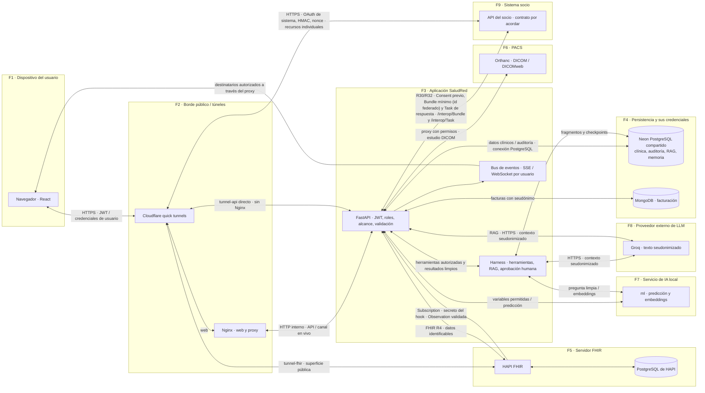

# Modelo de amenazas STRIDE

Actualizado: 20/11/2026. Alcance: R26 de los requisitos oficiales recibidos el 16/11, con los controles de R12 y R23–R32 que existen en el repositorio. La matriz distingue implementación, pruebas y despliegue: un control presente en código no demuestra que esté activo en Neon ni que la pila esté disponible.

## Flujo de datos y fronteras de confianza

Cada subgrafo marca una frontera: el navegador, el borde público, la API, la persistencia, FHIR, PACS, el servicio de IA y los proveedores externos tienen privilegios y datos diferentes. Estar en la misma red Docker no convierte un recurso recibido en confiable.

**Datos que cruzan las fronteras.** La API consulta datos personales para aplicar permisos y presentar la historia. El modelo de criticidad recibe una lista permitida de variables; el LLM recibe texto seudonimizado. Los mensajes de usuario, fragmentos del corpus y resultados de herramientas siguen siendo datos no confiables. HAPI y Orthanc pueden conservar identificadores clínicos: el cifrado de campos en PostgreSQL de la API no cifra automáticamente esas copias. El navegador solo recibe eventos de su usuario y alcance.

**Exposición real.** Los túneles de API y FHIR evitan Nginx. El límite de tasa de FastAPI cubre la API; no protege HAPI directamente. HTTPS termina en el borde y no acredita cifrado de todos los enlaces internos. Los recursos individuales `Observation` y `ServiceRequest` y el flujo completo `POST /interop/Bundle` y `POST /interop/Task` tienen receptor autenticado; el envío lo inicia `POST /api/v1/interop/remisiones` (código en `app/services/interop/roundtrip.py`, `envio.py` y `receptor.py`). El ciclo completo está probado contra SaludRed mismo; el socio de R33 aún no está asignado y las URL de los túneles rápidos cambian al reiniciarlos.

## Amenazas, controles y evidencia

Las normas son la correspondencia solicitada por el enunciado del curso y desarrollada en [NORMATIVA.md](NORMATIVA.md); la tabla no declara certificación de cumplimiento. Las rutas de prueba son evidencia reproducible del comportamiento, no una afirmación de prueba en producción. El resultado de ejecución se registra en [ENTREGA_FINAL.md](ENTREGA_FINAL.md).

| Categoría | Componente | Amenaza | Control | Evidencia | Riesgo residual | Norma |
|---|---|---|---|---|---|---|
| Spoofing (suplantación) | Navegador, Nginx/túnel, API | Un atacante usa un token alterado o una cuenta ajena para abrir historias; falsifica la IP mediante una cabecera | JWT con algoritmo fijo, `iss`, `aud` y vencimiento; cuenta y rol releídos; Argon2id y bloqueo por intentos; `TRUST_CF_CONNECTING_IP=false` por defecto | R02/R24; `app/core/security.py`, `app/services/auth.py`, `app/core/net.py`; `tests/test_security.py`, `tests/test_rate_limit.py` | Un token robado sirve hasta expirar o bloquear la cuenta. El despliegue del 11/11 registró 180 minutos, frente a 15 por defecto; decisión pendiente. Activar confianza en la cabecera con 8000 expuesto permitiría suplantar IP | Ley 1581/2012; Res. 1995/1999 |
| Spoofing (suplantación) | Socio, receptor FHIR | Un tercero se hace pasar por HAPI o por otro equipo | Secreto del hook comparado en tiempo constante; OAuth de sistema con audiencia y alcances separados, cliente activo releído, firma por mensaje | R29/R31; `app/api/routes/fhir_hooks.py`, `app/services/interop/`; `tests/test_fhir_hook.py`, `tests/test_interop_receiver.py` | Los secretos compartidos requieren custodia y rotación; aún no hay socio registrado para la demo cruzada | Ley 1581/2012; Res. 866/2021 |
| Tampering (manipulación) | Túnel, API de interoperabilidad, FHIR | Se cambia un resultado o se repite una remisión interceptada | HTTPS público; HMAC sobre cuerpo crudo, fecha y nonce; unicidad del nonce; validación de perfil LOINC/SNOMED/UCUM antes de procesar | R29; `tests/test_interop_receiver.py::test_a_body_changed_after_signing_is_401`, `test_the_same_message_twice_is_409_the_second_time`, `test_a_rejected_profile_message_stores_nothing`; `tests/test_interop_federado_perfil.py`; `tests/test_interop_roundtrip.py::test_an_invalid_bundle_is_a_422_with_an_operation_outcome_and_stores_nothing` | HMAC no cifra el cuerpo ni prueba su autor ante terceros. Un Bundle con una entrada inválida se rechaza completo (422 con `OperationOutcome`) y no almacena nada; con `INTEROP_REQUIRE_SIGNATURE=false` se omiten firma, fecha y nonce para ese socio | Res. 866/2021; Ley 1581/2012 |
| Tampering (manipulación) | PostgreSQL, reportes de IA | Se cambia un identificador cifrado o se presenta como aprobado un resultado pendiente | AES-256-GCM con AAD ligado al paciente y campo; revisión clínica para aprobar reportes y sugerencias | R27; `app/core/field_crypto.py`, `app/models/patient.py`; `tests/test_field_crypto.py`, `tests/test_patient_encryption.py`, `tests/test_ai_reports.py` | D1 pendiente: filas existentes en claro. El exportador a socios emite solo `DiagnosticReport` final desde informes de IA aprobados; uno pendiente o rechazado nunca se exporta (`app/fhir/diagnostic_report.py`; `tests/test_interop_roundtrip.py::test_a_pending_or_rejected_report_is_never_exported`) | Ley 1581/2012; Res. 1995/1999 |
| Repudiation (repudio) | API, auditoría PostgreSQL, socio | Un usuario niega una decisión o un administrador altera una fila auditada | Auditoría con actor/IP/origen; cadena de hashes; verificación solo admin; auditoría de herramientas con prefijo del resultado seudonimizado entregado al modelo | R24/R28; `app/services/audit_chain.py`, `app/services/agent/harness.py`; `tests/test_audit_chain.py`, `tests/test_agent_rag_audit.py`; `GET /api/v1/audit-logs/verify` | Borrar el final de la cadena requiere un hash publicado fuera de la BD para detectarlo. Filas previas a la cadena no se rellenan. HMAC simétrico no aporta no repudio criptográfico; payload auditado se limita a 3000 caracteres | Res. 1995/1999; Ley 1581/2012 |
| Information disclosure (fuga) | PostgreSQL, HAPI, PACS, MongoDB | Una copia de la base expone documentos, teléfonos y domicilios; acceso directo evita los permisos de la API | Cifrado de documento, teléfono, correo y dirección; índice ciego; API con rol/IPS/paciente; facturación seudonimizada y proxy PACS autorizado | R12/R27; `app/models/patient.py`, `app/services/pacs.py`, `app/services/pseudonymization.py`; `tests/test_patient_encryption.py`, `tests/test_pacs.py`, `tests/test_authz.py` | **Alto hasta D1:** los 481 pacientes existentes registrados en el handoff siguen sin recifrar. Copias antiguas, HAPI y metadatos DICOM no quedan protegidos por el cifrado de la API; el túnel FHIR es una superficie aparte | Ley 1581/2012; Res. 1995/1999 |
| Information disclosure (fuga) | Agente/RAG, servicio de IA, LLM, canal de eventos | Se envía una dirección al proveedor o un usuario recibe datos de otro paciente | Lista permitida para IA; limpieza por identidad y patrones, incluida dirección; resultado de herramienta limpio antes del LLM y de auditar; historia aprobada filtrada por seudónimo; canales por usuario/alcance; contable excluido | R12/R17/R23/R24; `app/services/rag/privacy.py`, `app/services/rag/store.py`, `app/services/agent/tools.py`; `tests/test_agent_rag_audit.py`, `tests/test_agent.py`, `tests/test_events_channel.py`, `tests/test_events_ws.py` | Seudonimización no equivale a anonimización. Nombres de terceros y domicilios sin formato reconocible, cuando no hay identidad abierta, no se detectan de forma exhaustiva. El payload auditado conserva información clínica y requiere permisos | Ley 1581/2012; Res. 1995/1999 |
| Denial of service | Nginx/túnel, API, DB, servicio de IA, LLM | Ráfagas agotan conexiones o cuota de Groq y dejan sin atención a otros usuarios | Límite de tasa en FastAPI y Nginx; límites de cuerpos externos (`MAX_BODY_BYTES`, `MAX_ENTRIES`); semáforos y tope de turnos; liberación de conexión antes del LLM; timeout y respuesta extractiva | `app/core/ratelimit.py`, `app/services/agent/harness.py`; `tests/test_rate_limit.py`, `tests/test_agent.py`, `tests/test_interop_receiver.py` | Contadores y bus en memoria, un solo worker; reiniciar los pierde. El túnel gratuito y la cuota externa no tienen disponibilidad garantizada. No se ha probado resistencia volumétrica | Res. 3100/2019; Ley 1581/2012 |
| Elevation of privilege | API, herramientas del agente, LLM, sistema socio | Una instrucción en una guía intenta consultar otro paciente o ejecutar una remisión sin permiso | Roles y alcance validados por backend; paciente fijo por hilo; aprobación humana; datos delimitados; detector y bloqueo temporal por usuario con IP auditada; credenciales de sistema rechazadas en rutas de usuario | R24/R25/R31; `app/services/agent/guard.py`, `security.py`, `tools.py`, `harness.py`; `tests/test_agent.py`, `tests/test_agent_rag_audit.py`, `tests/test_interop_receiver.py` | El detector usa patrones y no reconoce todas las inyecciones; la barrera de autorización es el backend. Un clínico puede aprobar una propuesta equivocada. El Consent por destino (R32) es una compuerta previa al envío, no una autorización clínica | Ley 1581/2012; Res. 1995/1999; Res. 866/2021 |
| Spoofing (suplantación) | `POST /interop/Task`, socio | Un socio responde por la remisión de otro socio | Correlación: la `ServiceRequest` original se busca por su identificador y por el socio autenticado; si no es suya o no existe, responde 404 sin revelar su existencia | R30/R31; `app/services/interop/roundtrip.py`; `tests/test_interop_roundtrip.py::test_another_partner_cannot_answer_a_referral_that_is_not_theirs` | Un socio con credenciales válidas puede responder con datos falsos sus propias remisiones; el contenido depende del acuerdo con el socio | Ley 1581/2012; Res. 866/2021 |
| Spoofing (suplantación) | Rutas `/interop/*`, configuración | Se acepta una credencial más débil que OAuth con firma | `INTEROP_ALLOW_API_KEY` (apagado por defecto) admite `X-Api-Key` solo en rutas `/interop/*`, nunca en `/api/v1`; `INTEROP_REQUIRE_SIGNATURE` (encendido por defecto) exige firma, fecha y nonce | `app/core/config.py` (`interop_allow_api_key`, `interop_require_signature`) | **Al relajarlos para un socio:** sin firma se omiten fecha y nonce, así que una repetición interceptada ya no se rechaza por nonce; con API key el secreto viaja en cada petición. Cada relajación debe acordarse con el socio y limitarse a su cliente | Ley 1581/2012; Res. 866/2021 |
| Tampering (manipulación) | `POST /interop/Task` | Se repite un Task o llega uno que contradice la respuesta registrada | Idempotencia: la misma respuesta repetida no cambia el estado; una distinta a la registrada responde 409 | R30; `app/services/interop/roundtrip.py`; `tests/test_interop_roundtrip.py::test_a_replayed_task_is_idempotent` | La primera respuesta registrada es definitiva; corregirla requiere intervención manual | Res. 866/2021 |
| Information disclosure (fuga) | Bundle de remisión, entrante y saliente | El Bundle lleva nombre, contacto o documento del paciente al socio | Bundle mínimo: solo el identificador federado, sin nombre, teléfono, dirección ni fecha de nacimiento; el receptor rechaza esos campos; solo evidencia aprobada. `INTEROP_SEND_DOCUMENT_IDENTIFIER` e `INTEROP_ACCEPT_DOCUMENT_IDENTIFIER` están apagados por defecto | R30; `app/services/interop/roundtrip.py`, `app/services/interop/federado.py`; `tests/test_minimal_bundle.py`, `tests/test_interop_roundtrip.py::test_the_bundle_is_minimal_and_carries_only_approved_evidence` | El identificador federado depende de `FEDERATED_SECRET`; si se filtra, el socio puede reidentificar. Activar el identificador por documento es una concesión a la minimización | Ley 1581/2012 |
| Information disclosure (fuga) | Compuerta de consentimiento | Se envían datos a una institución destino sin autorización del titular | Consent vigente por paciente y destino, verificado antes de cargar contenido clínico o usar el transporte; el rechazo queda auditado como `consent_denied`; solo médico o admin registran y revocan | R32; `app/services/consents.py`, `app/services/interop/envio.py`; `tests/test_consents_service.py`, `tests/test_consents_api.py`, `tests/test_interop_roundtrip.py::test_the_consent_gate_blocks_before_anything_is_built_or_sent` | El registro de un consentimiento no prueba que el titular lo otorgó; depende del procedimiento institucional | Ley 1581/2012 |
| Information disclosure (fuga) | Motivo de remisión (texto libre) | El motivo contiene un nombre o documento y viaja al socio | Limpieza con `privacy.scrub` ligada al paciente antes de salir: el motivo, el servicio y el motivo de rechazo del `Task` pierden nombre, documento, teléfono, correo y dirección; el registro local conserva el texto original del médico | `app/services/interop/roundtrip.py` (`scrub_for_partner`, `build_task`); `tests/test_interop_roundtrip.py::test_the_reason_and_the_service_sent_to_the_partner_carry_no_patient_identifier`, `::test_the_rejection_reason_in_the_task_carries_no_patient_identifier`; agente: `app/services/agent/tools.py` (`_scrub`) | Nombres de terceros o datos escritos de forma inusual pueden escapar a la limpieza por patrones | Ley 1581/2012 |
| Denial of service | `POST /interop/Bundle`, salida de Task | Un Bundle enorme o un socio lento agotan la API o bloquean al especialista | Topes `MAX_ENTRIES` y `MAX_BODY_BYTES` (413); bandeja de salida con tope `MAX_DELIVERY_ATTEMPTS`; el Task se entrega en segundo plano tras confirmar la decisión, así un socio lento no bloquea al especialista | `app/services/interop/roundtrip.py`, `app/services/interop/receptor.py`; `tests/test_interop_roundtrip.py::test_the_task_is_queued_before_the_response_and_sent_by_a_background_task`, `::test_a_transient_failure_is_retried_until_the_attempt_cap`, `::test_a_referral_with_hundreds_of_observations_is_capped_and_the_partner_accepts_it` | Un Task que agota los intentos queda sin entregar hasta intervención manual; la entrega en segundo plano corre en el mismo proceso | Res. 3100/2019 |
| Repudiation (repudio) | Remisión entre socios | Un lado niega haber enviado o recibido una remisión o su respuesta | Ambos lados auditan con `origen: "externo"` dentro de la cadena de hashes (recepción, consentimiento denegado, entrega del Task) | R28/R30; `app/services/interop/receptor.py`, `app/services/interop/roundtrip.py`, `app/services/audit_chain.py`; `tests/test_interop_roundtrip.py`, `tests/test_audit_chain.py` | La auditoría local no obliga al socio: su registro es suyo. HMAC simétrico no da no repudio criptográfico | Res. 1995/1999; Ley 1581/2012 |

## Pendientes y riesgos residuales

- D1: los 481 pacientes existentes en Neon siguen sin cifrar. Requiere aprobación y respaldo; el script conserva el ensayo en seco por defecto y no se ha ejecutado.
- R30 (ida y vuelta), R32 (consentimiento), el flujo Bundle y Task y el exportador con `DiagnosticReport` están implementados y probados contra SaludRed mismo; no hay evidencia de una ejecución con un socio externo.
- R33: el socio para la interoperabilidad no está asignado. Las opciones `INTEROP_ALLOW_API_KEY` e `INTEROP_REQUIRE_SIGNATURE=false` solo se activarían por acuerdo con él y debilitan los controles descritos arriba.
- Las URL de los túneles rápidos de Cloudflare cambian al reiniciarlos; el socio necesita la URL vigente y el túnel no ofrece disponibilidad garantizada.
- La lista de bloqueo del agente está en memoria (un solo worker): reiniciar la API la borra.
- R34: mantener la pila en línea toda la jornada, revisar el repositorio y resolver `tester.yaml` sin contraseñas antes de publicar. Las pruebas aisladas no demuestran disponibilidad pública.
- Publicación externa del hash de auditoría, revisión de la exposición de FHIR/PACS y decisión sobre la duración del token siguen documentadas en [ENTREGA_FINAL.md](ENTREGA_FINAL.md).
